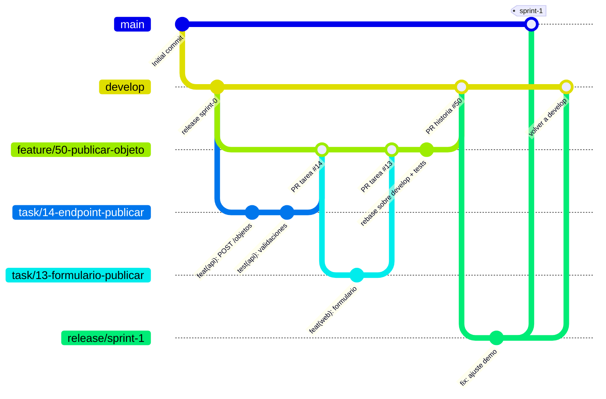

# Cómo trabajamos con Git (GitFlow)

Usamos **GitFlow**, con dos ramas permanentes:

- **`main`**: solo contiene versiones entregadas, es decir, lo que se enseña en cada demo. Cada versión lleva una etiqueta (`sprint-0`, `sprint-1`…).
- **`develop`**: la rama de integración. Aquí solo entran **historias de usuario completas** y probadas, así que siempre compila y pasa los tests.

Cada historia de usuario (o requisito técnico, o spike) se desarrolla en su propia rama `feature/`, que sale de `develop`. Cada tarea de esa historia se hace en una rama corta `task/` que sale de la rama de la historia y vuelve a ella mediante un Pull Request revisado. Cuando la historia está completa, se hace *rebase* sobre `develop`, se vuelve a probar y entra en `develop` con un *merge commit*. **Nunca se hace *squash***, para no perder el historial de las ramas. Al final del sprint, `develop` pasa a `main` a través de una rama de release.

> **Cambios respecto a versiones anteriores**
> - Sprint 0 (#20): pasamos de GitHub Flow a GitFlow para separar la integración diaria (`develop`) de la versión que se entrega en cada demo (`main`).
> - Sprint 1 (#160), tras la corrección del profesor en la demo del Sprint 0: antes usábamos una rama por tarea que entraba en `develop` con *squash*. Eso dejaba en `develop` funcionalidades a medias (por ejemplo, el formulario de registro llegó antes que su endpoint) y borraba el historial de cada rama. Ahora la rama es por historia, las tareas se integran dentro de ella y todo se fusiona sin *squash*.

## Diagrama



## Tipos de rama

| Rama | Para qué | Sale de | Vuelve a (por PR) | Forma de merge | Ejemplo |
|---|---|---|---|---|---|
| `main` | Versión entregada en cada demo | — | — | — | — |
| `develop` | Integración: solo historias completas | `main` (una sola vez) | — | — | — |
| `feature/<nº>-<desc>` | Una historia de usuario, requisito técnico (TR) o spike. `<nº>` = issue de la historia | `develop` | `develop` | Merge commit, tras *rebase* | `feature/50-publicar-objeto` |
| `task/<nº>-<desc>` | Una tarea de esa historia. `<nº>` = issue de la tarea | su `feature/` | su `feature/` | Merge commit | `task/14-endpoint-publicar` |
| `bugfix/<nº>-<desc>` | Bug encontrado en `develop` (aún no entregado) | `develop` | `develop` | Merge commit, tras *rebase* | `bugfix/120-validacion-email` |
| `release/sprint-<N>` | Preparar la demo: solo arreglos pequeños, nada nuevo | `develop` | `main` **y** `develop` | Merge commit | `release/sprint-1` |
| `hotfix/<nº>-<desc>` | Bug urgente en lo que ya está en `main` | `main` | `main` **y** `develop` | Merge commit | `hotfix/140-error-login` |

Nombres en minúsculas y con guiones. El `<nº>` es el del issue de GitHub.

## Reglas

### 1. Nadie hace push directo a `main` ni a `develop`
- Todo entra por Pull Request con al menos **1 aprobación de otra persona** (nunca el autor).
- GitHub lo impone: `main` y `develop` están protegidas con *rulesets* (Settings → Rules). En las dos, el PR con 1 aprobación es obligatorio y no se puede borrar la rama ni hacer *force push*; nadie se lo puede saltar, tampoco los administradores.

  | Rama | Ruleset | Forma de merge permitida |
  |---|---|---|
  | `develop` | `proteger-rama-develop` | Solo *Create a merge commit* (`feature/` y `bugfix/`) |
  | `main` | `proteger-rama-main` | Solo *Create a merge commit* (`release/` y `hotfix/`) |

  Cuando exista el CI (#19), se añadirá como requisito que esté en verde.
- `develop` es la rama por defecto del repositorio, para que los PRs se abran contra ella.
- Las ramas `feature/` no están protegidas por GitHub (hace falta poder hacer `--force-with-lease` después del *rebase*), pero se trabajan igual: nadie hace commits directos en ellas, todo entra desde ramas `task/` por PR.

### 2. Una rama `feature/` por historia
- La crea el responsable de la historia (o la primera persona que empieza una de sus tareas) desde `develop` actualizado, con el número del issue de la **historia** (US, TR o spike), no el de una tarea.
- Vive mientras dure la historia. Si una historia no cabe en el sprint, se parte en historias más pequeñas en la planning.
- Si la historia solo tiene una tarea, se puede trabajar directamente en la rama `feature/`, sin rama `task/`.

### 3. Una rama `task/` por tarea
- Sale de la rama `feature/` de su historia, actualizada, y dura **poco (1-3 días)**.
- Mantenla al día con la rama de la historia: `git rebase origin/feature/<nº>-<desc>` (es tu rama, así que puedes reescribirla).
- PR hacia la rama `feature/` de la historia, revisado por otra persona y con *Create a merge commit*.
- Si tu tarea necesita algo de otra tarea de la misma historia, espera a que esté en la rama de la historia. No crees ramas a partir de ramas de otras personas.

### 4. Integrar una historia en `develop`: rebase, tests y merge
Cuando todas las tareas de la historia están en su rama `feature/` (no queda ningún PR de tarea abierto):

1. **Rebase sobre `develop`**: `git fetch origin && git rebase --rebase-merges origin/develop`. Con `--rebase-merges` se conservan los merges de cada tarea; sin él, Git los aplana y se pierde la información de las ramas.
2. **Tests después del rebase**: `npm run lint`, `npm test` y `npm run build` en `backend/` y `frontend/`, y los e2e de la historia en `e2e/`. Si algo falla, se arregla en la rama de la historia antes de seguir.
3. **Subir la rama reescrita**: `git push --force-with-lease`. Nunca `--force` a secas: `--force-with-lease` falla si alguien ha subido algo que no tienes.
4. **PR de `feature/` a `develop`**, con CI en verde (cuando exista), 1 aprobación y **Create a merge commit**.
5. Se borra la rama y se cierra el issue de la historia.

El rebase reescribe la rama de la historia: avisa al equipo antes de hacerlo, porque cualquier rama `task/` que siga abierta tendría que rehacerse.

### 5. Commits
Formato [Conventional Commits](https://www.conventionalcommits.org/es/): `tipo(ámbito): descripción en presente (#issue)`

| Tipo | Para qué |
|---|---|
| `feat` | Funcionalidad nueva |
| `fix` | Corregir un bug |
| `docs` | Documentación |
| `test` | Tests |
| `refactor` | Mejorar código sin cambiar comportamiento |
| `chore` | Configuración, dependencias, CI, Docker |

```
chore(api): crea el proyecto base del backend (#17)
feat(api): añade el endpoint GET /api/health (#17)
feat(auth): añade el endpoint de registro con email único (#23)
docs(repo): cambia la estrategia de ramas a GitFlow (#20)
```

- Commits pequeños y frecuentes, cada uno con un cambio coherente. Como ya no hay *squash*, cada commit queda en `develop`: el mensaje tiene que tener sentido por sí solo y el código de cada commit tiene que compilar.
- El `(#issue)` del commit es el de la **tarea**.
- **Cada persona hace commits con su propia cuenta**: el email de `git config user.email` debe ser el de tu cuenta de GitHub; si no, el commit no aparece como tuyo.

### 6. Pull Requests
1. **Base del PR:** la rama `feature/` de su historia para `task/`; `develop` para `feature/` y `bugfix/`; `main` para `release/` y `hotfix/`.
2. Título con el mismo formato que los commits. El PR de una historia lleva su código: `feat(objetos): US-02.01 Publicar un objeto (#50)`.
3. En la descripción, `Closes #<nº>`. Ojo: GitHub solo cierra el issue automáticamente al llegar a la rama por defecto (`develop`). Los PRs de tarea cierran sus issues cuando la historia entra en `develop`.
4. Rellena la plantilla (criterios de aceptación, tests, capturas si hay UI, casilla de IA).
5. **Revisa otra persona del equipo** (nunca el autor). Como mínimo 1 aprobación.
6. El CI tiene que estar en verde (cuando exista el CI): en los PRs de tarea y en el de la historia.
7. Forma de integrar: siempre **Create a merge commit**. Nunca *Squash and merge* ni *Rebase and merge*. Tras el merge se borra la rama (salvo `main` y `develop`).

### 7. Final de cada sprint (release)
1. Cuando todas las historias del sprint están en `develop`, una persona crea `release/sprint-<N>` desde `develop`.
2. En esa rama solo se arreglan errores de la demo; nada de funcionalidades nuevas.
3. PR de `release/sprint-<N>` a `main`. Tras el merge, se etiqueta en `main`: `git tag sprint-<N>` y `git push origin sprint-<N>`.
4. PR de `release/sprint-<N>` a `develop`, para que los arreglos no se pierdan.
5. Lo que no esté en `main` al final del sprint no está entregado: vuelve al backlog. Una historia a medias se queda en su rama `feature/`, fuera de `develop`.

### 8. Despliegue
- Vercel y Render despliegan **desde `main`**: la URL pública se actualiza en cada release o hotfix, no con cada tarea.
- Las previews de Vercel se generan en cada PR y sirven para revisar antes del merge.

### 9. Tablero (GitHub Project)
| Momento | Columna |
|---|---|
| Creas la rama `task/` y empiezas | In progress (la tarea; la historia también, si es la primera) |
| Abres el PR de la tarea | Test |
| PR de la tarea mergeado en la rama de la historia | Result |
| Historia mergeada en `develop` | Done (la historia y todas sus tareas) |

### 10. Código generado con IA
Si una parte del código la ha generado una IA, indícalo en el PR (casilla de la plantilla) y, si es un bloque grande, con un comentario en el código, por ejemplo:

```
// Generado con asistencia de IA (Claude) – revisado por <nombre>, <fecha>
```

La revisión humana en el PR es obligatoria igualmente.

## Definition of Done
Una historia está terminada cuando:
- [ ] Cumple sus criterios de aceptación.
- [ ] Tiene tests (unitarios y/o e2e) y pasan **después del rebase sobre `develop`**.
- [ ] Cada tarea y la propia historia están revisadas y aprobadas por otra persona en un PR.
- [ ] Está mergeada en `develop` sin *squash* (y, al final del sprint, entregada en `main`).
- [ ] Funciona en el entorno desplegado (a partir del Sprint 1).
- [ ] La página de ayuda está actualizada si cambia algo visible para el usuario.

## Chuleta de comandos

```bash
# 1. Crear la rama de la historia (una vez por historia)
git switch develop
git pull
git switch -c feature/50-publicar-objeto
git push -u origin feature/50-publicar-objeto

# 2. Crear la rama de tu tarea desde la de la historia
git fetch origin
git switch -c task/14-endpoint-publicar origin/feature/50-publicar-objeto

# 3. Trabajar y hacer commits
git add .
git commit -m "feat(api): añade el endpoint para publicar un objeto (#14)"

# 4. Traer lo último de la historia a tu tarea
git fetch origin
git rebase origin/feature/50-publicar-objeto

# 5. Subir la tarea y abrir el PR contra la rama de la historia
git push -u origin task/14-endpoint-publicar      # tras un rebase: git push --force-with-lease
gh pr create --base feature/50-publicar-objeto --fill

# 6. Historia completa: rebase sobre develop, tests y PR a develop
git switch feature/50-publicar-objeto
git pull
git fetch origin
git rebase --rebase-merges origin/develop
(cd backend && npm run lint && npm test && npm run build)
(cd frontend && npm run lint && npm test && npm run build)
git push --force-with-lease
gh pr create --base develop --title "feat(objetos): US-02.01 Publicar un objeto (#50)"

# Release al final del sprint (una persona)
git switch develop && git pull
git switch -c release/sprint-1
git push -u origin release/sprint-1
gh pr create --base main --title "release: sprint 1"
```
