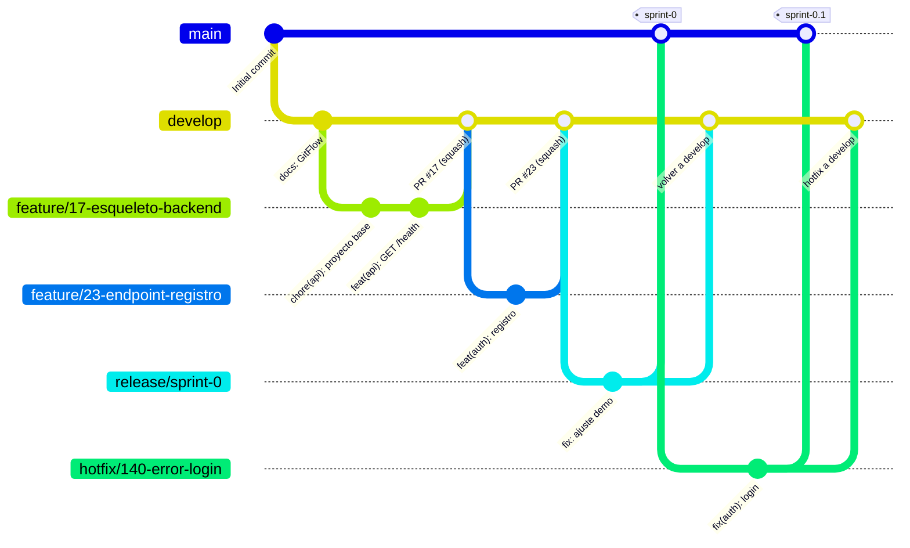

# Cómo trabajamos con Git (GitFlow)

Usamos **GitFlow**, con dos ramas permanentes:

- **`main`**: solo contiene versiones entregadas, es decir, lo que se enseña en cada demo. Cada versión lleva una etiqueta (`sprint-0`, `sprint-1`…).
- **`develop`**: la rama de integración. Aquí se juntan todas las tareas terminadas durante el sprint.

Cada tarea se hace en una rama corta que sale de `develop` y vuelve a `develop` mediante un Pull Request revisado por otra persona del equipo. Al final del sprint, `develop` pasa a `main` a través de una rama de release.

> Cambio respecto a la primera versión (GitHub Flow): pasamos a GitFlow en el Sprint 0 (#20) para separar la integración diaria (`develop`) de la versión que se entrega en cada demo (`main`). Así, `main` solo cambia cuando el equipo decide que una versión está lista.

## Diagrama



## Tipos de rama

| Rama | Para qué | Sale de | Vuelve a (por PR) | Ejemplo |
|---|---|---|---|---|
| `main` | Versión entregada en cada demo | — | — | — |
| `develop` | Integración del sprint | `main` (una sola vez) | — | — |
| `feature/<nº>-<desc>` | Cualquier tarea: funcionalidad, docs, tests, configuración, spikes | `develop` | `develop` | `feature/23-endpoint-registro` |
| `bugfix/<nº>-<desc>` | Bug encontrado en `develop` (aún no entregado) | `develop` | `develop` | `bugfix/120-validacion-email` |
| `release/sprint-<N>` | Preparar la demo: solo arreglos pequeños, nada nuevo | `develop` | `main` **y** `develop` | `release/sprint-0` |
| `hotfix/<nº>-<desc>` | Bug urgente en lo que ya está en `main` | `main` | `main` **y** `develop` | `hotfix/140-error-login` |

Nombres en minúsculas y con guiones. El `<nº>` es el del issue de GitHub.

## Reglas

### 1. Nadie hace push directo a `main` ni a `develop`
- Todo entra por Pull Request con al menos **1 aprobación de otra persona** (nunca el autor).
- GitHub lo impone: `main` y `develop` están protegidas con *rulesets* (Settings → Rules). En las dos, el PR con 1 aprobación es obligatorio y no se puede borrar la rama ni hacer *force push*; nadie se lo puede saltar, tampoco los administradores.

  | Rama | Ruleset | Forma de merge permitida |
  |---|---|---|
  | `develop` | `proteger-rama-develop` | Solo *Squash and merge* (`feature/` y `bugfix/`) |
  | `main` | `proteger-rama-main` | Solo *Create a merge commit* (`release/` y `hotfix/`) |

  Cuando exista el CI (#19), se añadirá como requisito que esté en verde.
- `develop` es la rama por defecto del repositorio, para que los PRs se abran contra ella.

### 2. Una rama `feature/` por tarea
- Sale siempre de `develop` actualizado y dura **poco (1-3 días)**. Si una tarea es más larga, se integra por partes.
- Mantén la rama al día con `develop` a menudo (`git merge origin/develop`) para evitar conflictos grandes.
- Si tu tarea necesita algo de otra tarea que aún no está en `develop`, espera a que se mergee o habla con su responsable. No crees ramas a partir de ramas de otras personas.

### 3. Commits
Formato [Conventional Commits](https://www.conventionalcommits.org/es/): `tipo(ámbito): descripción en presente (#issue)`

| Tipo | Para qué |
|---|---|
| `feat` | Funcionalidad nueva |
| `fix` | Corregir un bug |
| `docs` | Documentación |
| `test` | Tests |
| `refactor` | Mejorar código sin cambiar comportamiento |
| `chore` | Configuración, dependencias, CI, Docker |

```
chore(api): crea el proyecto base del backend (#17)
feat(api): añade el endpoint GET /api/health (#17)
feat(auth): añade el endpoint de registro con email único (#23)
docs(repo): cambia la estrategia de ramas a GitFlow (#20)
```

- Commits pequeños y frecuentes, cada uno con un cambio coherente.
- **Cada persona hace commits con su propia cuenta**: el email de `git config user.email` debe ser el de tu cuenta de GitHub; si no, el commit no aparece como tuyo.

### 4. Pull Requests
1. **Base del PR:** `develop` para `feature/` y `bugfix/`; `main` para `release/` y `hotfix/`.
2. Título con el mismo formato que los commits.
3. En la descripción, `Closes #<nº>`. Ojo: GitHub solo cierra el issue automáticamente al llegar a la rama por defecto (`develop`).
4. Rellena la plantilla (criterios de aceptación, tests, capturas si hay UI, casilla de IA).
5. **Revisa otra persona del equipo** (nunca el autor). Como mínimo 1 aprobación.
6. El CI tiene que estar en verde (cuando exista el CI).
7. Forma de integrar:
   - `feature/` y `bugfix/` → **Squash and merge** y se borra la rama.
   - `release/` y `hotfix/` → **Create a merge commit** (sin squash), para que `main` y `develop` compartan historia. Después se abre un segundo PR de la misma rama hacia `develop`.

### 5. Final de cada sprint (release)
1. Cuando todo lo del sprint está en `develop`, una persona crea `release/sprint-<N>` desde `develop`.
2. En esa rama solo se arreglan errores de la demo; nada de funcionalidades nuevas.
3. PR de `release/sprint-<N>` a `main`. Tras el merge, se etiqueta en `main`: `git tag sprint-<N>` y `git push origin sprint-<N>`.
4. PR de `release/sprint-<N>` a `develop`, para que los arreglos no se pierdan.
5. Lo que no esté en `main` al final del sprint no está entregado: vuelve al backlog.

### 6. Despliegue
- Vercel y Render despliegan **desde `main`**: la URL pública se actualiza en cada release o hotfix, no con cada tarea.
- Las previews de Vercel se generan en cada PR y sirven para revisar antes del merge a `develop`.

### 7. Tablero (GitHub Project)
| Momento | Columna |
|---|---|
| Creas la rama y empiezas | In progress |
| Abres el PR | Test |
| PR aprobado y mergeado en `develop` | Done |

### 8. Código generado con IA
Si una parte del código la ha generado una IA, indícalo en el PR (casilla de la plantilla) y, si es un bloque grande, con un comentario en el código, por ejemplo:

```
// Generado con asistencia de IA (Claude) – revisado por <nombre>, <fecha>
```

La revisión humana en el PR es obligatoria igualmente.

## Definition of Done
Una tarea está terminada cuando:
- [ ] Cumple los criterios de aceptación de su historia.
- [ ] Tiene tests (unitarios y/o e2e) y pasan.
- [ ] Está revisada y aprobada por otra persona en un PR.
- [ ] Está mergeada en `develop` (y, al final del sprint, entregada en `main`).
- [ ] Funciona en el entorno desplegado (a partir del Sprint 1).
- [ ] La página de ayuda está actualizada si cambia algo visible para el usuario.

## Chuleta de comandos

```bash
# 1. Partir de develop actualizado
git switch develop
git pull

# 2. Crear la rama de la tarea
git switch -c feature/23-endpoint-registro

# 3. Trabajar y hacer commits
git add .
git commit -m "feat(auth): añade endpoint de registro (#23)"

# 4. Traer los últimos cambios de develop a tu rama
git fetch origin
git merge origin/develop

# 5. Subir la rama y abrir el PR contra develop
git push -u origin feature/23-endpoint-registro
gh pr create --base develop --fill

# Release al final del sprint (una persona)
git switch develop && git pull
git switch -c release/sprint-0
git push -u origin release/sprint-0
gh pr create --base main --title "release: sprint 0"
```