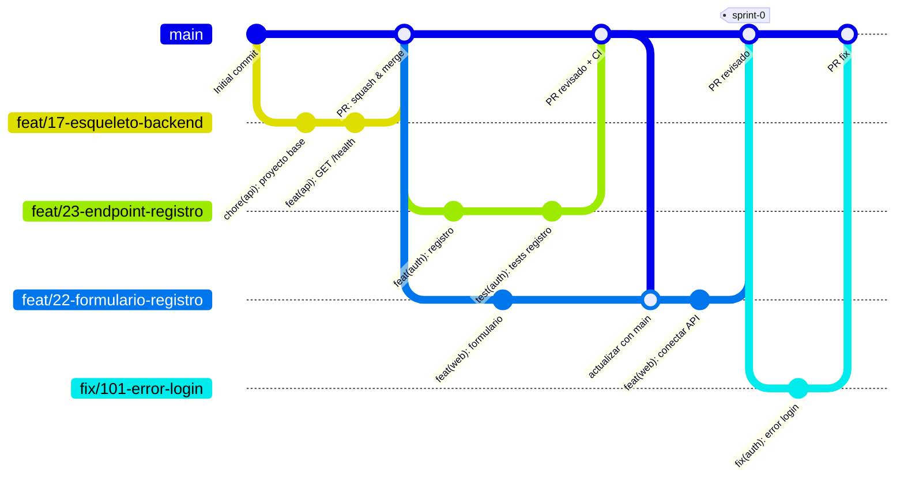

# Cómo trabajamos con Git (estrategia de ramas)

Usamos **GitHub Flow**: una única rama principal (`main`) que siempre funciona, y una rama corta por cada tarea que se integra en `main` mediante un Pull Request revisado por otra persona del equipo.

Lo elegimos frente a GitFlow porque somos 6, los sprints son de 2-3 semanas y desplegamos desde `main`: GitFlow (`develop`, `release/*`, `hotfix/*`) añade ramas y merges que no necesitamos.

## Diagrama



## Reglas

### 1. `main` siempre funciona
- Nadie hace `push` directo a `main`: todo entra por Pull Request.
- `main` es lo que se despliega y lo que se enseña en la demo.
- GitHub no permite proteger ramas en repos privados de organizaciones gratuitas, así que esta regla es un **acuerdo del equipo**. Si el repo pasa a ser público, se activará la protección (PR obligatorio + 1 aprobación + CI en verde).

### 2. Una rama por tarea (issue)
Formato: `tipo/<nº issue>-<descripcion-corta>` en minúsculas y con guiones.

| Tipo | Para qué | Ejemplo |
|---|---|---|
| `feat` | Funcionalidad nueva | `feat/23-endpoint-registro` |
| `fix` | Corregir un bug | `fix/101-error-login` |
| `docs` | Documentación | `docs/98-diagrama-er` |
| `test` | Tests (e2e, unitarios) | `test/21-e2e-registro` |
| `refactor` | Mejorar código sin cambiar comportamiento | `refactor/40-servicio-auth` |
| `chore` | Configuración, dependencias, CI | `chore/19-ci-github-actions` |
| `spike` | Investigación / prototipo | `spike/92-almacenamiento-imagenes` |

- Las ramas duran **poco (1-3 días)**. Si una tarea es más larga, se integra por partes.
- Mantén tu rama al día con `main` a menudo para evitar conflictos grandes.

### 3. Commits
Formato [Conventional Commits](https://www.conventionalcommits.org/es/): `tipo(ámbito): descripción en presente (#issue)`

```
feat(auth): añade endpoint de registro con email único (#23)
fix(web): muestra el error cuando el email ya existe (#24)
test(auth): e2e de inicio de sesión (#102)
```

- Commits pequeños y frecuentes, cada uno con un cambio coherente.
- **Cada persona hace commits con su propia cuenta**: el email de `git config user.email` debe ser el de tu cuenta de GitHub; si no, el commit no aparece como tuyo.

### 4. Pull Requests
1. Título con el mismo formato que los commits.
2. En la descripción, `Closes #<nº>` para que el issue se cierre al hacer merge.
3. Rellena la plantilla (criterios de aceptación, tests, capturas si hay UI).
4. **Revisa otra persona del equipo** (nunca el autor). Como mínimo 1 aprobación.
5. El CI tiene que estar en verde (cuando exista el CI).
6. Se integra con **Squash and merge** y se borra la rama.

### 5. Tablero (GitHub Project)
| Momento | Columna |
|---|---|
| Creas la rama y empiezas | In progress |
| Abres el PR | Test |
| PR aprobado y mergeado | Done |

### 6. Final de cada sprint
- Se etiqueta en `main` el commit que se enseña en la demo: `sprint-0`, `sprint-1`, `sprint-2`, `sprint-3`.
- Lo que no esté mergeado en `main` no está hecho: vuelve al backlog.

### 7. Código generado con IA
Si una parte del código la ha generado una IA, indícalo en el PR (casilla de la plantilla) y, si es un bloque grande, con un comentario en el código, por ejemplo:

```
// Generado con asistencia de IA (Claude) – revisado por <nombre>, <fecha>
```

La revisión humana en el PR es obligatoria igualmente.

## Definition of Done
Una tarea está terminada cuando:
- [ ] Cumple los criterios de aceptación de su historia.
- [ ] Tiene tests (unitarios y/o e2e) y pasan.
- [ ] Está revisada y aprobada por otra persona en un PR.
- [ ] Está mergeada en `main` y funciona en el entorno desplegado (a partir del Sprint 1).
- [ ] La página de ayuda está actualizada si cambia algo visible para el usuario.

## Chuleta de comandos

```bash
# 1. Partir de main actualizado
git switch main
git pull

# 2. Crear la rama de la tarea
git switch -c feat/23-endpoint-registro

# 3. Trabajar y hacer commits
git add .
git commit -m "feat(auth): añade endpoint de registro (#23)"

# 4. Traer los últimos cambios de main a tu rama
git fetch origin
git merge origin/main

# 5. Subir la rama y abrir el PR
git push -u origin feat/23-endpoint-registro
gh pr create --fill
```
