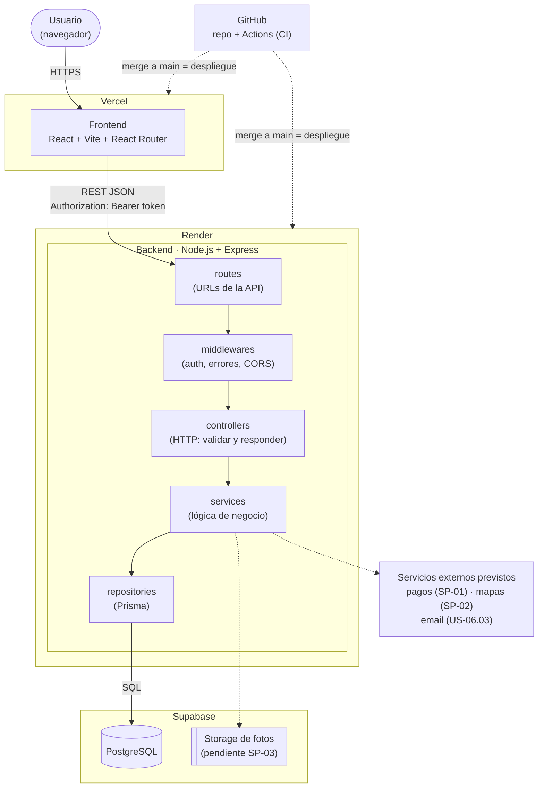
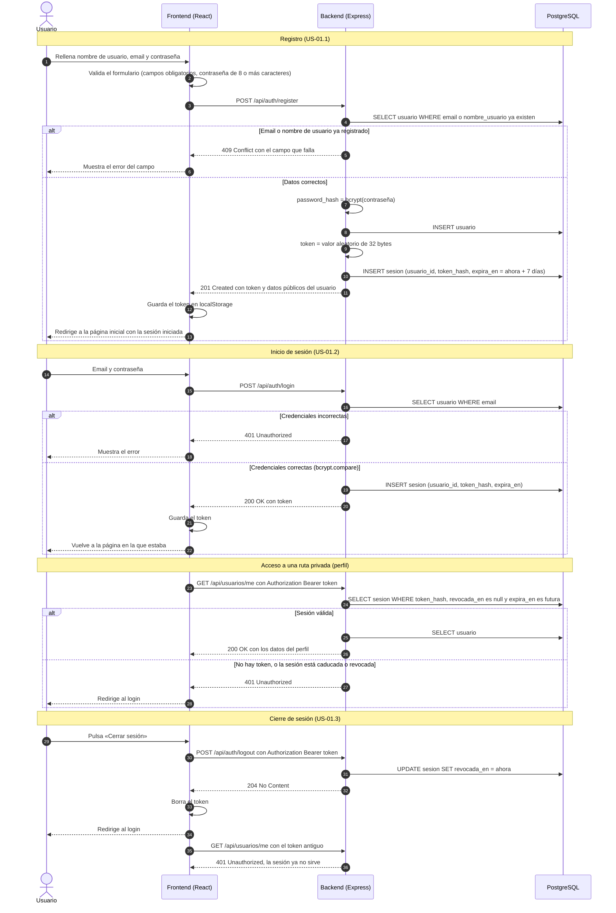

# Arquitectura de Rentit

Decisiones de diseño del Sprint 0 (tarea #129, parte de TR-02 · #83). Este documento se enseña en la demo del Sprint 0 y se actualiza cuando cambie la arquitectura.

> Generado con asistencia de IA (Claude) – revisado por Kai Oliveros.

- Stack y alternativas descartadas: [ADR 0001 · Stack tecnológico](adr/0001-stack.md)
- Modelo de datos (tablas `usuario` y `sesion`): [modelo-datos.md](modelo-datos.md)
- Flujo de trabajo con Git: [CONTRIBUTING.md](../CONTRIBUTING.md)

> Siguiendo el **diseño emergente** de la asignatura, aquí solo se describe lo necesario para el Sprint 0 (registro, inicio y cierre de sesión) más los servicios externos ya previstos. Las piezas marcadas como *pendiente de spike* se decidirán en SP-01…SP-05.

## 1. Vista general



| Pieza | Responsabilidad | Ejemplo en el Sprint 0 |
|---|---|---|
| **Frontend** | Pantallas, navegación y validación de formularios. Guarda el token de sesión y lo envía en cada petición. | Formularios de registro y login, pantalla de perfil, botón «Cerrar sesión». |
| **routes** | Asocia cada URL y método HTTP a un controller. | `POST /api/auth/register` |
| **middlewares** | Lógica común a muchas rutas: comprobar el token, CORS, convertir errores en respuestas JSON. | `requireAuth` protege `/api/usuarios/me`. |
| **controllers** | Leen y validan la petición, llaman al service y construyen la respuesta HTTP. No tienen lógica de negocio. | Devuelven 201, 400, 401 o 409. |
| **services** | Reglas de negocio, sin saber nada de HTTP. | "El email no puede estar repetido", cifrar la contraseña, crear o revocar sesiones. |
| **repositories** | Único sitio que habla con la base de datos (Prisma). | `usuarioRepo.findByEmail()` |
| **PostgreSQL** | Datos persistentes. | Tablas `usuario` y `sesion`. |

**Regla de dependencias:** cada capa solo llama a la de su derecha. Así se pueden testear los services sin levantar Express y cambiar la BD sin tocar los controllers.

## 2. Flujo de autenticación

Usamos un **token de sesión opaco** (un valor aleatorio, no un JWT). En la BD solo se guarda su **hash** en `sesion.token_hash`, así que aunque alguien leyera la base de datos no podría usar las sesiones. Cerrar sesión rellena `sesion.revocada_en`, y a partir de ese momento ese token da **401** (criterio de US-01.3).



Endpoints del Sprint 0:

| Método y ruta | Auth | Respuestas | Tarea |
|---|---|---|---|
| `GET /api/health` | no | 200 `{ "status": "ok" }` | #17 |
| `POST /api/auth/register` | no | 201 · 400 datos inválidos · 409 email/usuario repetido | #23 |
| `POST /api/auth/login` | no | 200 · 400 · 401 credenciales incorrectas | #26 |
| `GET /api/usuarios/me` | sí | 200 · 401 | #28 |
| `POST /api/auth/logout` | sí | 204 · 401 | #103 |

> Los nombres exactos de las rutas los fija BE al implementar; si cambian, se actualiza esta tabla en el mismo PR.

## 3. Estructura de carpetas

Mono-repo con el front y el back separados (ver la justificación en el [ADR 0001](adr/0001-stack.md)). Es la estructura **prevista**: los esqueletos reales los crean FE (#31) y BE (#17), y si difieren se actualiza este apartado.

```text
Proyecto/
├── frontend/                  # React + Vite (desplegado en Vercel)
│   ├── src/
│   │   ├── pages/             # Una carpeta o archivo por pantalla (Login, Registro, Perfil, Home)
│   │   ├── components/        # Componentes reutilizables (Layout, Navbar, campo de contraseña…)
│   │   ├── services/          # Cliente de la API: fetch + cabecera Authorization
│   │   ├── context/           # AuthContext: token y usuario actual
│   │   ├── routes/            # Definición de rutas y PrivateRoute (redirige al login)
│   │   └── main.tsx
│   ├── tests/                 # Tests unitarios (Vitest)
│   └── package.json
├── backend/                   # Node.js + Express (desplegado en Render)
│   ├── src/
│   │   ├── routes/            # URL → controller
│   │   ├── controllers/       # HTTP: validar petición, responder
│   │   ├── services/          # Lógica de negocio
│   │   ├── repositories/      # Acceso a datos con Prisma
│   │   ├── middlewares/       # requireAuth, manejo de errores, CORS
│   │   ├── config/            # Lectura de variables de entorno
│   │   └── app.ts             # Crea la app Express (sin arrancarla, para los tests)
│   ├── prisma/
│   │   ├── schema.prisma      # Esquema de la BD
│   │   ├── migrations/        # Migraciones versionadas (#98)
│   │   └── seed.ts            # Datos de desarrollo y demo
│   ├── tests/                 # Tests unitarios y de API (Vitest + Supertest)
│   └── package.json
├── e2e/                       # Tests de aceptación con Playwright (#99)
├── docs/
│   ├── adr/                   # Architecture Decision Records
│   ├── arquitectura.md        # Este documento
│   └── modelo-datos.md        # Diagrama ER
├── .github/
│   ├── workflows/             # GitHub Actions: CI (Sprint 1, #19)
│   └── pull_request_template.md
├── docker-compose.yml         # PostgreSQL local para desarrollo
├── .env.example               # Variables necesarias, sin valores reales (#100)
├── CONTRIBUTING.md            # Ramas, commits y PRs
└── README.md                  # Cómo arrancar el proyecto (#30)
```

## 4. Despliegue

| Entorno | Frontend | Backend | Base de datos | Cuándo se actualiza |
|---|---|---|---|---|
| Local | `npm run dev` (Vite) | `npm run dev` | PostgreSQL en Docker | Cada desarrollador |
| Preview | URL de Vercel por PR | — | — | Al abrir o actualizar un PR |
| Producción | URL pública de Vercel | URL pública de Render | Supabase | Al hacer merge a `main` |

El CI (lint + tests + build en cada PR), el despliegue continuo y la gestión de secretos son tareas del Sprint 1 (#19, #96, #100).
