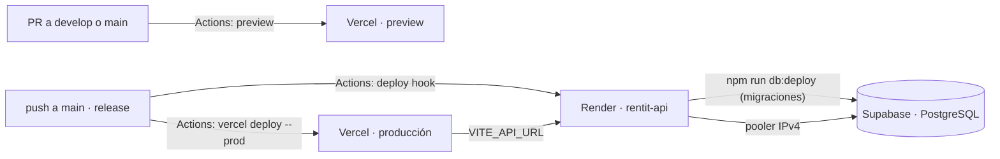

# Despliegue en producción

Cómo está montada la URL pública de Rentit (TR-04 · #85: tareas #96 y #97; secretos en #100) y qué hay que configurar a mano la primera vez. Sigue el [ADR 0001](adr/0001-stack.md): frontend en **Vercel**, backend en **Render** y PostgreSQL en **Supabase**, todo en planes gratuitos.

> Generado con asistencia de IA (Claude) – revisado por Marc Sanz, 25/10/2026.

**Estado (25/10/2026):** configurado. Frontend en https://rentit-eosin.vercel.app (proyecto `rentit` del *scope* `marcsanz-dev` en Vercel) y backend en https://rentit-api-gfkc.onrender.com (`rentit-api`, Frankfurt), con Supabase en Frankfurt. Los secretos `VERCEL_*` y `RENDER_DEPLOY_HOOK_URL` y la variable `API_URL` ya están en GitHub. Ahora mismo está desplegada la versión del Sprint 0 (`main`).

## Cómo funciona

- **Solo se despliega a producción desde `main`**, es decir, en cada release o hotfix (CONTRIBUTING, «Despliegue»).
- Cada PR hacia `develop` o `main` genera una **preview** del frontend; la URL sale en el resumen del job «Despliegue del frontend / Vercel».
- **Migraciones automáticas (#97):** el backend arranca con `npm run db:deploy && npm start`, así que cada despliegue aplica las migraciones nuevas antes de servir peticiones.
- Los dos despliegues los lanza **GitHub Actions** (`.github/workflows/deploy-frontend.yml` y `deploy-backend.yml`), no las integraciones Git de Vercel y Render:
  - En el plan Hobby, Vercel bloquea los despliegues de repos de una **organización** y de commits de personas que no son la dueña de la cuenta ([foro de Vercel](https://community.vercel.com/t/why-cant-hobby-accounts-deploy-from-organizations/10015), [otro caso](https://community.vercel.com/t/vercel-deployment-blocked-because-commit-author-does-not-have-contributing-access-on-hobby-plan/36192)). Nuestro repo es de la organización `UB-ES-A1-2026` y mergeamos personas distintas.
  - Instalar las apps de GitHub de Vercel o Render en la organización lo tendría que aprobar su dueño (el profesor).
  - Con la CLI de Vercel (token) y el *deploy hook* de Render no hace falta ninguna de las dos cosas.
- Mientras falten los secretos, los dos workflows avisan y terminan **en verde sin desplegar**: no bloquean a nadie.
- El despliegue del frontend son **dos jobs en máquinas distintas**: *Build* compila el código (también el de un PR) **sin el token de Vercel**, y *Vercel* despliega lo ya compilado con el token, sin ejecutar código del repo. Así un PR no puede leer el token (revisión de Kai en #165).

## Configuración inicial (una vez, la hace la persona de DevOps)

Necesitas cuentas en Supabase, Render y Vercel (las tres gratis y sin tarjeta) y ser admin del repo. **Ninguna clave se escribe en el repo ni en el chat**: van solo en los paneles de cada servicio y en *Settings → Secrets and variables → Actions* de GitHub.

### 1. Supabase (base de datos)
1. *New project* → nombre `rentit`, región **Central EU (Frankfurt)**, contraseña larga generada (guárdala en tu gestor de contraseñas).
2. *Connect* → copia las dos cadenas del **pooler** (no la «Direct connection», que solo funciona por IPv6 y Render no la alcanza):
   - **Transaction pooler** (puerto **6543**) → será `DATABASE_URL`, añadiendo `?pgbouncer=true` al final.
   - **Session pooler** (puerto **5432**) → será `DIRECT_URL` (la usa `prisma migrate deploy`).

### 2. Render (backend)
1. *New → Web Service → Public Git Repository* → `https://github.com/UB-ES-A1-2026/Proyecto`.
2. Configuración:

   | Campo | Valor |
   |---|---|
   | Name | `rentit-api` |
   | Region | Frankfurt (la misma zona que Supabase) |
   | Branch | `main` |
   | Root Directory | `backend` |
   | Runtime | Node |
   | Build Command | `npm ci && npm run build` |
   | Start Command | `npm run db:deploy && npm start` |
   | Instance Type | Free |
   | Health Check Path | `/api/health` (en *Settings → Health Checks*) |
   | Auto-Deploy | No (lo lanza GitHub Actions) |

3. *Environment*:

   | Variable | Valor |
   |---|---|
   | `NODE_VERSION` | `22` |
   | `DATABASE_URL` | Transaction pooler de Supabase + `?pgbouncer=true` |
   | `DIRECT_URL` | Session pooler de Supabase |
   | `CORS_ORIGINS` | De momento vacío; en el paso 4, la URL de producción de Vercel |
   | `CORS_PREVIEW_PATTERN` | Se rellena en el paso 4 |
   | `BCRYPT_ROUNDS` | `10` |

   `PORT` no se pone: lo da Render.
4. *Settings → Deploy Hook* → copia la URL y guárdala en GitHub como **secreto** `RENDER_DEPLOY_HOOK_URL`.
5. En GitHub, *Variables* (no secretos) → `API_URL` = `https://<servicio>.onrender.com/api`. El workflow la usa para comprobar que la API responde después de desplegar.

### 3. Vercel (frontend)
1. En tu ordenador, desde la **raíz** del repo: `npx vercel@63.1.0 link` → crea el proyecto `rentit` en tu cuenta (sin conectar Git). Genera `.vercel/project.json` (está en `.gitignore`), con `orgId` y `projectId`.
2. En el panel del proyecto → *Settings*:
   - *Build and Deployment* → **Root Directory = `frontend`**, *Framework* = Vite.
   - *Environment Variables* → `VITE_API_URL` = `https://<servicio>.onrender.com/api`, en **Production** y **Preview**.
3. *Account Settings → Tokens* → crea un token solo para este proyecto, con caducidad al final del curso.
4. En GitHub, **secretos**: `VERCEL_TOKEN`, `VERCEL_ORG_ID` y `VERCEL_PROJECT_ID` (los dos últimos, de `.vercel/project.json`).

### 4. CORS (otra vez en Render)
- `CORS_ORIGINS` = la URL de producción de Vercel, sin barra final (por ejemplo, `https://rentit-xyz.vercel.app`).
- `CORS_PREVIEW_PATTERN` = expresión de las previews con el nombre del proyecto y tu *scope* de Vercel (lo que va después del último guion en la URL de una preview). Por ejemplo, `^https://rentit-[a-z0-9-]+-<scope>\.vercel\.app$` (en nuestro caso, `<scope>` = `marcsanz-dev`). El backend no arranca si la expresión no está anclada o si acepta cualquier `*.vercel.app` (ADR 0001 §3).

> **`CORS_PREVIEW_PATTERN` no es una barrera de seguridad.** En `vercel.app` cualquiera puede crear un proyecto con un nombre que encaje con el patrón. No pasa nada grave porque la sesión va en la cabecera `Authorization` y no en cookies: una web ajena con CORS permitido no puede usar la sesión de nadie. El CORS solo evita que otras webs usen nuestra API desde el navegador por accidente; la seguridad la dan `requireAuth` y los permisos de los services.

### 5. Primer despliegue y comprobación
1. *Actions → Despliegue del backend → Run workflow* y *Despliegue del frontend → Run workflow*. Desde `develop`, el frontend sale como preview; producción llega con la siguiente release a `main`.
2. Comprueba:
   - `https://<servicio>.onrender.com/api/health` → `{"status":"ok"}`.
   - En la URL de Vercel: registrarse, iniciar sesión, recargar `/perfil` (sin 404 gracias a `frontend/vercel.json`) y cerrar sesión.
   - El smoke test contra producción, desde `e2e/`: `BASE_URL=<url de Vercel> API_URL=<url de Render>/api npm run test:smoke`.
3. Pon la URL pública en el README («Demo / producción»).

## Cuentas y accesos

- Los proyectos de **Vercel** (*scope* `marcsanz-dev`), **Render** (`rentit-api`) y **Supabase** están en las cuentas personales de Marc, la persona de DevOps del Sprint 1. El plan Hobby de Vercel es de **una sola persona** (no se pueden invitar miembros).
- Si un día hace falta tocar algo y Marc no está, cualquier admin del repo puede:
  - lanzar o repetir un despliegue desde *Actions* (*Run workflow*);
  - en una emergencia, montarlo todo de nuevo en sus propias cuentas siguiendo esta guía (~45 min) y cambiar los secretos de GitHub.
- En Render y en Supabase, si el plan gratuito permite invitar a otra persona al *workspace* u organización, invita a la persona de DevOps del sprint siguiente.
- `VERCEL_TOKEN` tiene **alcance limitado** (solo el *scope* `marcsanz-dev`) y **caduca a los 90 días** (finales de enero de 2027). Si caduca antes de acabar el curso, se crea otro y se sustituye el secreto.
- Al cambiar de DevOps en cada sprint, el traspaso es esta guía más acceso a los paneles si se puede. Las claves nunca se pasan por WhatsApp.

## Datos en producción

- **No ejecutes nunca `npm run db:seed` contra producción.** El seed de desarrollo crea `admin@rentit.test` con una contraseña que está en el repo, que es público.
- Los datos de demo (#97) se crearán con un seed aparte, con contraseñas que no estén en el repo, cuando existan los objetos (Sprint 1).
- Las previews usan el mismo backend y la misma BD que producción (ADR 0001 §4): prueba con cuentas de prueba, nunca con los datos de la demo.

## Problemas conocidos

| Síntoma | Causa | Qué hacer |
|---|---|---|
| La primera petición tarda ~1 min | Render free se duerme tras 15 min sin tráfico | Abrir `/api/health` unos minutos antes de la demo |
| `P1001: Can't reach database server` en Render | Se ha puesto la conexión directa (IPv6) | Usar las URLs del **pooler** (paso 1) |
| `prepared statement already exists` | Falta `?pgbouncer=true` en `DATABASE_URL` | Añadirlo |
| Error de CORS en el navegador | La URL de Vercel no está en `CORS_ORIGINS` o no encaja con `CORS_PREVIEW_PATTERN` | Revisar el paso 4 |
| 404 al recargar una ruta | Falta `frontend/vercel.json` | Ya está en el repo; comprueba que Root Directory sea `frontend` |
| Supabase en pausa | Más de 7 días sin actividad (plan gratuito) | *Restore* en el panel de Supabase |
