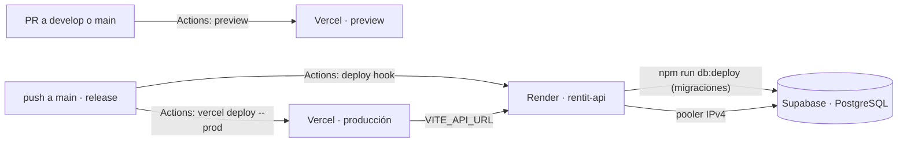
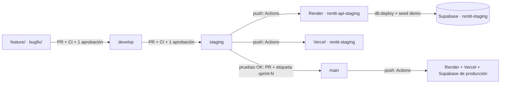

# Despliegue en producción

Cómo está montada la URL pública de Rentit (TR-04 · #85: tareas #96 y #97; secretos en #100) y qué hay que configurar a mano la primera vez. Sigue el [ADR 0001](adr/0001-stack.md): frontend en **Vercel**, backend en **Render** y PostgreSQL en **Supabase**, todo en planes gratuitos.

> Generado con asistencia de IA (Claude) – revisado por Marc Sanz, 25/10/2026.
> La sección «Preproducción (staging)» (US-12.03, #278 y #279): generado con asistencia de IA (Claude) – revisado por Maxim Nicolau, 11/11/2026.

**Estado (25/10/2026):** configurado. Frontend en https://rentit-ub.vercel.app (proyecto `rentit` del *scope* `marcsanz-dev` en Vercel) y backend en https://rentit-api-gfkc.onrender.com (`rentit-api`, Frankfurt), con Supabase en Frankfurt. Los secretos `VERCEL_*` y `RENDER_DEPLOY_HOOK_URL` y la variable `API_URL` ya están en GitHub. Ahora mismo está desplegada la versión del Sprint 0 (`main`).

**Preproducción (11/11/2026):** la rama `staging` despliega un segundo entorno completo, con otras cuentas y otra base de datos, antes de pasar a producción. Su guía está en [«Preproducción (staging)»](#preproducción-staging) y los servicios los monta Max. La rama `staging`, el Environment `staging` (con su política de ramas) y la regla `proteger-rama-staging` ya están creados en GitHub; solo falta que Max cree los servicios y ponga los secretos y variables `STAGING_*`. Si falta alguno, el workflow de `staging` queda **en rojo** (no en verde): el Environment existe, así que faltar configuración es un error.

## Cómo funciona

- **Solo se despliega a producción desde `main`**, es decir, en cada release de `staging` o hotfix (CONTRIBUTING, «Despliegue»). Un push a `staging` despliega **preproducción** (sección siguiente).
- Cada PR hacia `develop` o `main` genera una **preview** del frontend; la URL sale en el resumen del job «Despliegue del frontend / Vercel».
- **Migraciones automáticas (#97):** el backend arranca con `npm run db:deploy && npm start`, así que cada despliegue aplica las migraciones nuevas antes de servir peticiones.
- Los dos despliegues los lanza **GitHub Actions** (`.github/workflows/deploy-frontend.yml` y `deploy-backend.yml`), no las integraciones Git de Vercel y Render:
  - En el plan Hobby, Vercel bloquea los despliegues de repos de una **organización** y de commits de personas que no son la dueña de la cuenta ([foro de Vercel](https://community.vercel.com/t/why-cant-hobby-accounts-deploy-from-organizations/10015), [otro caso](https://community.vercel.com/t/vercel-deployment-blocked-because-commit-author-does-not-have-contributing-access-on-hobby-plan/36192)). Nuestro repo es de la organización `UB-ES-A1-2026` y mergeamos personas distintas.
  - Instalar las apps de GitHub de Vercel o Render en la organización lo tendría que aprobar su dueño (el profesor).
  - Con la CLI de Vercel (token) y el *deploy hook* de Render no hace falta ninguna de las dos cosas.
- Mientras falten los secretos de **producción** (`VERCEL_*`, `RENDER_DEPLOY_HOOK_URL`), los dos workflows avisan y terminan **en verde sin desplegar**: no bloquean a nadie. En **preproducción** no es así: faltar un `STAGING_*` deja el job en rojo.
- El despliegue del backend a producción solo corre desde `main` (push o *Run workflow* elegido sobre `main`); lanzarlo a mano desde `develop` o una rama no hace nada.
- El despliegue del frontend son **dos jobs en máquinas distintas**: *Build* compila el código (también el de un PR) **sin el token de Vercel**, y *Vercel* despliega lo ya compilado con el token, sin ejecutar código del repo. Así un PR no puede leer el token (revisión de Kai en #165).

## Preproducción (staging)

Desde el Sprint 2 (US-12.03, #276) no se pasa de `develop` a `main` directamente: antes se despliega la versión en **preproducción**, un entorno igual que producción pero con sus propios servicios y su propia base de datos, y allí se prueba (smoke test e2e y pruebas a mano). Solo cuando todo está bien se hace el PR a `main`.

- Un **push a `staging`** lanza los mismos dos workflows que producción (`deploy-backend.yml` y `deploy-frontend.yml`), pero con los secretos y servicios de preproducción. Un push a `main` sigue desplegando producción exactamente como antes.
- Backend: se comprueba que existan `STAGING_RENDER_DEPLOY_HOOK_URL` y `STAGING_API_URL` (si no, error), se lanza el *deploy hook* de `rentit-api-staging`, se espera a que `$STAGING_API_URL/health` responda (cada intento con `--max-time 10`) y, solo entonces, un job aplica las migraciones y carga los datos de demo en la BD de preproducción (`npm run db:deploy` y `npm run db:seed:demo`).
- Frontend: se despliega al proyecto `rentit-staging` como producción **de ese proyecto** (URL estable). Con la misma separación de seguridad que producción: el build, que ejecuta código del repo, va sin token.
- El smoke test e2e contra preproducción lo añade la tarea T5 (#280) como un job más de `deploy-backend.yml` con `needs: seed`, que tiene que **fallar si `seed` no terminó en éxito** (un seed saltado no puede dejar el smoke en verde). Necesita las variables `STAGING_WEB_URL` y `STAGING_API_URL`.
- **Si algo falla** (falta un `STAGING_*`, el hook, que la API no responda, una migración o el seed), el workflow queda en **rojo**. Ese check rojo en el commit de `staging` es la señal: no se abre el PR a `main` hasta arreglarlo (con un `bugfix/` hacia `staging`, CONTRIBUTING regla 7). Lo mismo si falla el smoke test.
- Los PR hacia `staging` pasan el CI y gitleaks, pero **no generan preview** del frontend: usaría el proyecto y el backend de producción, y la versión ya se previsualizó en sus PR a `develop`.

### Por qué cuentas separadas

| | Producción | Preproducción |
|---|---|---|
| Supabase, Render, Vercel | Cuentas de Marc | Cuentas de **Max** |
| Base de datos | `rentit` | `rentit-staging` |
| Fotos | `rentit-fotos` | `rentit-fotos-staging` |
| Secretos en GitHub | Nivel repo (`RENDER_DEPLOY_HOOK_URL`, `VERCEL_*`…) | Environment `staging` (`STAGING_*`) |

Los datos y las claves **no se comparten nunca**: así, un seed o una migración que salga mal en preproducción no puede tocar los datos reales, y lo que se prueba allí (incluidos los datos de demo, que son públicos en el repo) no mezcla cuentas de prueba con las de producción. Es lo que pide la historia: «las claves y la base de datos de producción nunca se usan en preproducción, ni al revés».

### Guía para montar preproducción (la hace Max, una vez)

Es la misma guía de producción de más abajo, con otros nombres y en tus cuentas. **Ninguna clave se escribe en el repo ni en el chat.** Ya están creados en GitHub la rama `staging`, el Environment `staging` (solo despliega la rama `staging`) y la regla `proteger-rama-staging`; a Max le quedan los servicios (P1–P3) y los secretos y variables del Environment (P4).

#### P1. Supabase
1. *New project* → nombre `rentit-staging`, región **Central EU (Frankfurt)**, contraseña larga generada y guardada en tu gestor de contraseñas.
2. *Connect* → copia las dos cadenas del **pooler** (como en el paso 1 de producción): *Transaction pooler* (6543, con `?pgbouncer=true`) → `DATABASE_URL` de Render y secreto `STAGING_DATABASE_URL`; *Session pooler* (5432) → `DIRECT_URL` de Render y secreto `STAGING_DIRECT_URL`.
3. **Storage → New bucket** `rentit-fotos-staging`, **privado**. En *Project Settings → Storage → S3 Connection* copia el *Endpoint* y la *Region* y crea una *S3 Access Key* (el *Secret* solo se ve una vez), como en el paso 6 de producción.

#### P2. Render
1. *New → Web Service → Public Git Repository* → `https://github.com/UB-ES-A1-2026/Proyecto`, con la tabla del paso 2 de producción pero:

   | Campo | Valor |
   |---|---|
   | Name | `rentit-api-staging` |
   | Branch | **`staging`** |
   | Auto-Deploy | **No** (lo lanza GitHub Actions) |
   | Region, Root Directory, Runtime, Build/Start Command, Instance Type, Health Check Path | Igual que producción (`backend`, `npm ci && npm run build`, `npm run db:deploy && npm start`, `/api/health`…) |

2. *Environment*, igual que producción pero con los valores de preproducción:

   | Variable | Valor |
   |---|---|
   | `NODE_VERSION` | `22` |
   | `DATABASE_URL` / `DIRECT_URL` | Los dos pooler de `rentit-staging` |
   | `CORS_ORIGINS` | La URL de Vercel de `rentit-staging`, sin barra final (se rellena después del paso P3) |
   | `BCRYPT_ROUNDS` | `10` |
   | `S3_BUCKET` | `rentit-fotos-staging` |
   | `S3_ENDPOINT`, `S3_REGION`, `S3_ACCESS_KEY_ID`, `S3_SECRET_ACCESS_KEY` | Los de `rentit-staging` (paso P1.3) |
   | `S3_FORCE_PATH_STYLE` | `true` |

   `CORS_PREVIEW_PATTERN` no hace falta: preproducción no tiene previews.
3. *Settings → Deploy Hook* → será el secreto `STAGING_RENDER_DEPLOY_HOOK_URL`. La URL de la API (`https://rentit-api-staging.onrender.com/api`, el dominio exacto lo da Render) será la variable `STAGING_API_URL`.

#### P3. Vercel
1. En **otra copia** del repo (otra carpeta, para no pisar el `.vercel/` de producción si lo tienes): `npx vercel@63.1.0 link` desde la raíz y crea el proyecto `rentit-staging` en tu cuenta Hobby, sin conectar Git. Si prefieres no tener otra copia: `npx vercel@63.1.0 link --project rentit-staging`. Esto genera `.vercel/project.json` (en `.gitignore`) con `orgId` y `projectId`.
2. *Settings → Build and Deployment*: **Root Directory = `frontend`**, *Framework* = Vite.
3. *Environment Variables*: `VITE_API_URL` = la URL de la API de preproducción (`…/api`), en **Production** (el workflow despliega con `--prod`).
4. *Account Settings → Tokens*: crea un token solo para este proyecto, con caducidad al final del curso.
5. Con la URL del proyecto, vuelve a Render y rellena `CORS_ORIGINS`.

#### P4. GitHub: secretos y variables del Environment `staging`
El Environment `staging` **ya existe**, con *Deployment branches and tags → Selected branches* = solo `staging` (así ninguna otra rama ni PR puede leer estos secretos) y sin aprobadores: el control de calidad es el PR a `staging`. Solo hay que añadirle los secretos y variables.

Secretos y variables **del Environment `staging`** (no del repo):

| Nombre | Tipo | Valor |
|---|---|---|
| `STAGING_RENDER_DEPLOY_HOOK_URL` | Secreto | Deploy hook de `rentit-api-staging` |
| `STAGING_VERCEL_TOKEN` | Secreto | Token de Vercel del paso P3 |
| `STAGING_VERCEL_ORG_ID` | Secreto | `orgId` de `.vercel/project.json` |
| `STAGING_VERCEL_PROJECT_ID` | Secreto | `projectId` de `.vercel/project.json` |
| `STAGING_DATABASE_URL` | Secreto | Transaction pooler de `rentit-staging` (6543, `?pgbouncer=true`) |
| `STAGING_DIRECT_URL` | Secreto | Session pooler de `rentit-staging` (5432) |
| `STAGING_DEMO_PASSWORD` | Secreto | Contraseña de las cuentas de demo de preproducción (12+ caracteres) |
| `STAGING_API_URL` | Variable | `https://<servicio>.onrender.com/api` de preproducción |
| `STAGING_WEB_URL` | Variable | URL de Vercel de `rentit-staging` (para el smoke test, T5) |

> **Por qué nombres distintos y no los de producción en otro Environment.** Si el secreto de staging se llamara igual que uno de producción que está a nivel de repo (por ejemplo, `DEMO_PASSWORD` o `PROD_DATABASE_URL`) y faltara en el Environment, GitHub usaría **en silencio el valor de producción**: un push a `staging` podría cargar los datos de demo en la BD de producción. Con prefijo `STAGING_*` nadie más tiene ese nombre, y si falta, el workflow lo dice y se para. Por eso los jobs de preproducción solo usan nombres `STAGING_*` y los de producción no declaran el Environment.

#### P5. Primer despliegue y comprobación
El orden importa: hoy `staging` es una copia de `develop` **sin** los workflows nuevos, y lo que está en `staging` solo conoce los secretos de producción.
1. **Max** crea los servicios (P1–P3) y pone los secretos y variables en el Environment `staging` (P4).
2. Esta historia (US-12.03) se mergea en `develop`.
3. Se abre un PR `develop` → `staging` (CI y 1 aprobación de otra persona) y se mergea. **Ese push es el primer despliegue**: lanza solo los dos workflows con los secretos de preproducción. A partir de ahí, cada push a `staging` los lanza.
4. Comprobaciones (abajo).

> **No lances ningún workflow de despliegue sobre `staging` antes del paso 3** (ni *Run workflow* con la rama `staging`): hasta entonces `staging` lleva los workflows antiguos, que solo conocen los secretos de producción.

**Comprobaciones:**
   - `https://<servicio>.onrender.com/api/health` → `{"status":"ok"}`.
   - Los jobs «Render (preproducción)» y «Migraciones y datos de demo» en verde.
   - En la URL de `rentit-staging`: entra con `laura@demo.rentit.test` y la contraseña `STAGING_DEMO_PASSWORD`, mira los objetos de la demo y publica uno con foto.
   - El smoke test a mano, desde `e2e/`: `BASE_URL=<URL de Vercel de staging> API_URL=<URL de Render de staging>/api npm run test:smoke`.

## Configuración inicial (una vez, la hace la persona de DevOps)

Necesitas cuentas en Supabase, Render y Vercel (las tres gratis y sin tarjeta) y ser admin del repo. **Ninguna clave se escribe en el repo ni en el chat**: van solo en los paneles de cada servicio y en *Settings → Secrets and variables → Actions* de GitHub.

### 1. Supabase (base de datos)
1. *New project* → nombre `rentit`, región **Central EU (Frankfurt)**, contraseña larga generada (guárdala en tu gestor de contraseñas).
2. *Connect* → copia las dos cadenas del **pooler** (no la «Direct connection», que solo funciona por IPv6 y Render no la alcanza):
   - **Transaction pooler** (puerto **6543**) → será `DATABASE_URL`, añadiendo `?pgbouncer=true` al final.
   - **Session pooler** (puerto **5432**) → será `DIRECT_URL` (la usa `prisma migrate deploy`).

### 2. Render (backend)
1. *New → Web Service → Public Git Repository* → `https://github.com/UB-ES-A1-2026/Proyecto`.
2. Configuración:

   | Campo | Valor |
   |---|---|
   | Name | `rentit-api` |
   | Region | Frankfurt (la misma zona que Supabase) |
   | Branch | `main` |
   | Root Directory | `backend` |
   | Runtime | Node |
   | Build Command | `npm ci && npm run build` |
   | Start Command | `npm run db:deploy && npm start` |
   | Instance Type | Free |
   | Health Check Path | `/api/health` (en *Settings → Health Checks*) |
   | Auto-Deploy | No (lo lanza GitHub Actions) |

3. *Environment*:

   | Variable | Valor |
   |---|---|
   | `NODE_VERSION` | `22` |
   | `DATABASE_URL` | Transaction pooler de Supabase + `?pgbouncer=true` |
   | `DIRECT_URL` | Session pooler de Supabase |
   | `CORS_ORIGINS` | De momento vacío; en el paso 4, la URL de producción de Vercel |
   | `CORS_PREVIEW_PATTERN` | Se rellena en el paso 4 |
   | `BCRYPT_ROUNDS` | `10` |

   `PORT` no se pone: lo da Render.
4. *Settings → Deploy Hook* → copia la URL y guárdala en GitHub como **secreto** `RENDER_DEPLOY_HOOK_URL`.
5. En GitHub, *Variables* (no secretos) → `API_URL` = `https://<servicio>.onrender.com/api`. El workflow la usa para comprobar que la API responde después de desplegar.

### 3. Vercel (frontend)
1. En tu ordenador, desde la **raíz** del repo: `npx vercel@63.1.0 link` → crea el proyecto `rentit` en tu cuenta (sin conectar Git). Genera `.vercel/project.json` (está en `.gitignore`), con `orgId` y `projectId`.
2. En el panel del proyecto → *Settings*:
   - *Build and Deployment* → **Root Directory = `frontend`**, *Framework* = Vite.
   - *Environment Variables* → `VITE_API_URL` = `https://<servicio>.onrender.com/api`, en **Production** y **Preview**.
3. *Account Settings → Tokens* → crea un token solo para este proyecto, con caducidad al final del curso.
4. En GitHub, **secretos**: `VERCEL_TOKEN`, `VERCEL_ORG_ID` y `VERCEL_PROJECT_ID` (los dos últimos, de `.vercel/project.json`).

### 4. CORS (otra vez en Render)
- `CORS_ORIGINS` = la URL de producción de Vercel, sin barra final (por ejemplo, `https://rentit-xyz.vercel.app`). **Si cambia el dominio de Vercel, hay que cambiarla también:** si no, la API rechaza a la web y sale «No se puede conectar con el servidor».
- `CORS_PREVIEW_PATTERN` = expresión de las previews con el nombre del proyecto y tu *scope* de Vercel (lo que va después del último guion en la URL de una preview). Por ejemplo, `^https://rentit-[a-z0-9-]+-<scope>\.vercel\.app$` (en nuestro caso, `<scope>` = `marcsanz-dev`). El backend no arranca si la expresión no está anclada o si acepta cualquier `*.vercel.app` (ADR 0001 §3).

> **`CORS_PREVIEW_PATTERN` no es una barrera de seguridad.** En `vercel.app` cualquiera puede crear un proyecto con un nombre que encaje con el patrón. No pasa nada grave porque la sesión va en la cabecera `Authorization` y no en cookies: una web ajena con CORS permitido no puede usar la sesión de nadie. El CORS solo evita que otras webs usen nuestra API desde el navegador por accidente; la seguridad la dan `requireAuth` y los permisos de los services.

### 5. Primer despliegue y comprobación
1. *Actions → Despliegue del backend → Run workflow* con la rama **`main`** (el backend de producción solo se despliega desde `main`; desde otra rama el job no corre) y *Despliegue del frontend → Run workflow*. Si lanzas el frontend desde `develop`, sale como preview; producción llega con la siguiente release a `main`.
2. Comprueba:
   - `https://<servicio>.onrender.com/api/health` → `{"status":"ok"}`.
   - En la URL de Vercel: registrarse, iniciar sesión, recargar `/perfil` (sin 404 gracias a `frontend/vercel.json`) y cerrar sesión.
   - El smoke test contra producción, desde `e2e/`: `BASE_URL=<url de Vercel> API_URL=<url de Render>/api npm run test:smoke`.
3. Pon la URL pública en el README («Demo / producción»).

### 6. Fotos de los objetos (Supabase Storage)
Las fotos van a un bucket **privado** de Supabase Storage a través de su API de S3 ([ADR 0002](adr/0002-almacenamiento-imagenes.md), #106). Mientras no esté configurado, la API funciona igual y la subida de fotos responde `503`.

1. En Supabase → **Storage → New bucket**: nombre `rentit-fotos`, **sin** marcar *Public bucket*.
2. En **Project Settings → Storage → S3 Connection**: copia el *Endpoint* y la *Region*, y en **S3 Access Keys → New access key** crea una clave (el *Secret* solo se ve una vez).
3. En Render → `rentit-api` → **Environment**, añade:

   | Variable | Valor |
   |---|---|
   | `S3_BUCKET` | `rentit-fotos` |
   | `S3_ENDPOINT` | El *Endpoint* del paso 2 (`https://<proyecto>.supabase.co/storage/v1/s3`) |
   | `S3_REGION` | La *Region* del paso 2 |
   | `S3_ACCESS_KEY_ID` | El *Access key ID* |
   | `S3_SECRET_ACCESS_KEY` | El *Secret access key* (secreto: solo en Render) |
   | `S3_FORCE_PATH_STYLE` | `true` |

4. Guarda: Render vuelve a desplegar solo. Comprueba la subida desde la web publicando un objeto con foto. Si el navegador da un error de CORS al hacer el `PUT`, revisa la configuración de CORS del bucket en Supabase.

## Cuentas y accesos

- Los proyectos de **Vercel** (*scope* `marcsanz-dev`), **Render** (`rentit-api`) y **Supabase** están en las cuentas personales de Marc, la persona de DevOps del Sprint 1. El plan Hobby de Vercel es de **una sola persona** (no se pueden invitar miembros).
- Si un día hace falta tocar algo y Marc no está, cualquier admin del repo puede:
  - lanzar o repetir un despliegue desde *Actions* (*Run workflow*);
  - en una emergencia, montarlo todo de nuevo en sus propias cuentas siguiendo esta guía (~45 min) y cambiar los secretos de GitHub.
- En Render y en Supabase, si el plan gratuito permite invitar a otra persona al *workspace* u organización, invita a la persona de DevOps del sprint siguiente.
- `VERCEL_TOKEN` tiene **alcance limitado** (solo el *scope* `marcsanz-dev`) y **caduca a los 90 días** (finales de enero de 2027). Si caduca antes de acabar el curso, se crea otro y se sustituye el secreto.
- Al cambiar de DevOps en cada sprint, el traspaso es esta guía más acceso a los paneles si se puede. Las claves nunca se pasan por WhatsApp.

## Datos en producción

- **No ejecutes nunca `npm run db:seed` contra producción.** El seed de desarrollo crea `admin@rentit.test` con una contraseña que está en el repo, que es público.
- Las previews usan el mismo backend y la misma BD que producción (ADR 0001 §4): prueba con cuentas de prueba, nunca con los datos de la demo. Esto sigue siendo así: **preproducción no tiene previews**, solo el despliegue de `staging`.

### Datos de demo (#97)

Para que la demo no salga vacía, el seed `backend/prisma/seed-demo.ts` crea en producción 3 cuentas y los objetos de ejemplo de `backend/prisma/demoData.ts` (varias categorías y barrios, uno de ellos pausado). Los mismos objetos los crea `npm run db:seed` en local, a nombre de `ana` y `bruno`.

| Cuenta | Objetos |
|---|---|
| `laura@demo.rentit.test` | Gràcia: taladro, escalera, carro de la compra y una tienda de campaña **pausada** |
| `jordi@demo.rentit.test` | Poblenou: proyector, altavoz, bici y máquina de palomitas |
| `marta@demo.rentit.test` | Sant Andreu: cortacésped, hidrolimpiadora, silla de bebé y paddle surf |

La contraseña de las tres es el secreto `DEMO_PASSWORD`: **no está en el repo**, tiene como mínimo 12 caracteres y el script se niega a usar la del seed de desarrollo. La persona de DevOps la comparte con el equipo en persona, nunca por WhatsApp.

**Primera vez:** en *Settings → Secrets and variables → Actions* del repo, añade estos secretos (los valores de las dos URLs son los mismos que `DATABASE_URL` y `DIRECT_URL` en Render):

| Secreto | Valor |
|---|---|
| `PROD_DATABASE_URL` | URL del pooler de Supabase (puerto 6543, con `?pgbouncer=true`) |
| `PROD_DIRECT_URL` | URL directa del pooler (puerto 5432) |
| `DEMO_PASSWORD` | La contraseña de las cuentas de la demo |

**Cargar los datos:** después de cada release a `main` que cambie las tablas o el catálogo, *Actions → «Datos de demo» → Run workflow*, rama **`main`**, y escribe `produccion` en la confirmación. Se puede repetir sin miedo: actualiza las cuentas y los objetos en lugar de duplicarlos, y no toca nada de lo que hayan creado otros usuarios. En local se puede probar con `DEMO_PASSWORD=<12+ caracteres> npm run db:seed:demo`.

Los objetos de la demo todavía no tienen fotos: llegarán con la subida de fotos (#106).

## Problemas conocidos

| Síntoma | Causa | Qué hacer |
|---|---|---|
| La primera petición tarda ~1 min | Render free se duerme tras 15 min sin tráfico | Abrir `/api/health` unos minutos antes de la demo |
| `P1001: Can't reach database server` en Render | Se ha puesto la conexión directa (IPv6) | Usar las URLs del **pooler** (paso 1) |
| `prepared statement already exists` | Falta `?pgbouncer=true` en `DATABASE_URL` | Añadirlo |
| Error de CORS en el navegador | La URL de Vercel no está en `CORS_ORIGINS` o no encaja con `CORS_PREVIEW_PATTERN` | Revisar el paso 4 |
| 404 al recargar una ruta | Falta `frontend/vercel.json` | Ya está en el repo; comprueba que Root Directory sea `frontend` |
| Supabase en pausa | Más de 7 días sin actividad (plan gratuito) | *Restore* en el panel de Supabase |
| El workflow de `staging` tarda o falla en «Esperar a que la API de preproducción responda» | Render free también duerme `rentit-api-staging` y el primer arranque tarda | Se espera hasta unos 18 min en el peor caso; si sigue en rojo, mira los logs en Render y repite con *Re-run jobs* |
| El job «Migraciones y datos de demo» no sale | Falta algún secreto `STAGING_*` del Environment `staging`, o el workflow se lanzó desde otra rama (el Environment solo admite `staging`) | Con un secreto o variable `STAGING_*` ausente el job «Render (preproducción)» o «Build (preproducción)» ya queda en rojo con el nombre que falta. Revisa la tabla de la sección de preproducción |
