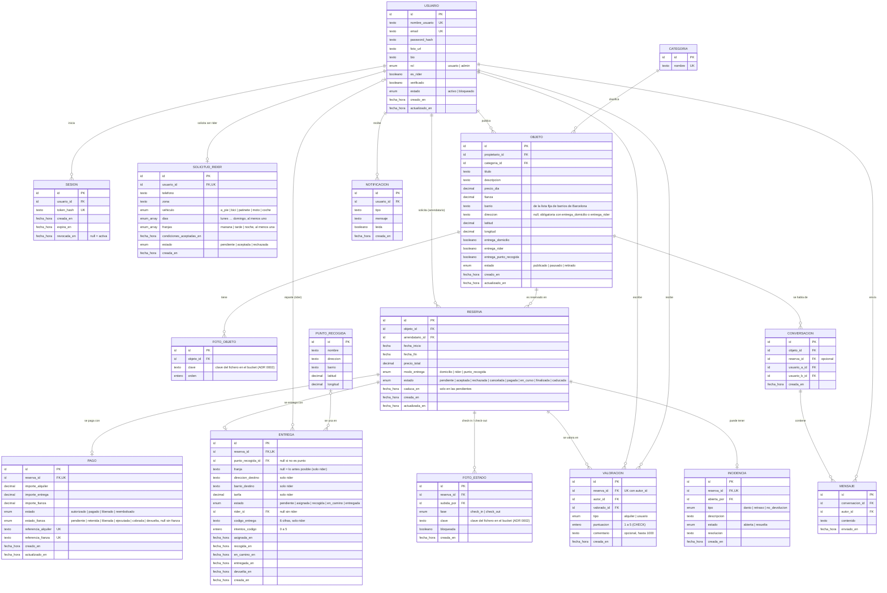

# Modelo de datos

Diagrama entidad-relación inicial de Rentit (TR-05 · #86, tarea #98). Es **independiente del stack**: los tipos son genéricos y se traducirán a las migraciones cuando esté decidido el framework y la base de datos.

Siguiendo el diseño emergente que pide la asignatura, en cada sprint solo se crean las tablas que necesitan sus historias (ver la última sección). El diagrama completo sirve de guía para que las tablas encajen entre sí.

> Generado con asistencia de IA (Claude) – revisado por Marc Sanz.

## Diagrama ER

## Tabla `usuario` (Sprint 0 · #18)

Es la única tabla que necesita el Sprint 0 (registro, inicio y cierre de sesión), junto con `sesion`.

| Campo | Tipo | Obligatorio | Restricciones | Para qué |
|---|---|---|---|---|
| `id` | id (entero autoincremental o UUID) | sí | PK | Identificador |
| `nombre_usuario` | texto (3-30) | sí | único | US-01.1: campo «nombre de usuario» |
| `email` | texto (≤ 255) | sí | único, guardado en minúsculas | US-01.1 / US-01.2: login por correo |
| `password_hash` | texto | sí | nunca la contraseña en claro (bcrypt o argon2) | Seguridad |
| `foto_url` | texto | no | | US-01.4 perfil público (S2) |
| `bio` | texto (≤ 500) | no | | US-01.4 perfil público (S2) |
| `rol` | enum `usuario`, `admin` | sí | por defecto `usuario` | US-11.01 panel admin (S3) |
| `es_rider` | booleano | sí | por defecto `false` | US-10.01 riders (S2) |
| `verificado` | booleano | sí | por defecto `false` | US-01.5 verificación (si da tiempo) |
| `estado` | enum `activo`, `bloqueado` | sí | por defecto `activo` | Bloqueo desde el panel admin |
| `creado_en` | fecha y hora | sí | por defecto «ahora» | Auditoría |
| `actualizado_en` | fecha y hora | sí | se actualiza al modificar | Auditoría |

Reglas que deben cumplir los endpoints:
- El registro rechaza un `email` o `nombre_usuario` ya existente (criterio de US-01.1).
- La contraseña tiene como mínimo 8 caracteres (criterio de Jira para US-01) y se guarda solo como hash.
- Los campos de S2/S3 se pueden añadir más adelante con una migración nueva; están aquí para que el diseño no cambie de forma.

## Tabla `sesion` (Sprint 0 · #26 y #103)

Permite que el **cierre de sesión invalide la sesión de verdad** (criterio de US-01.3), tanto si usamos cookies de sesión como tokens.

| Campo | Tipo | Restricciones | Para qué |
|---|---|---|---|
| `id` | id | PK | |
| `usuario_id` | id | FK → `usuario.id`, borrado en cascada | Dueño de la sesión |
| `token_hash` | texto | único | Hash del token o del id de sesión (nunca el valor en claro) |
| `creada_en` | fecha y hora | | |
| `expira_en` | fecha y hora | | Caducidad (por ejemplo, 7 días) |
| `revocada_en` | fecha y hora | null = activa | El logout la rellena; una sesión revocada o caducada da 401 |

Si el stack usa JWT sin estado, esta tabla funciona como lista de tokens revocados (guardando el `jti`).

## Fotos: se guarda la clave, no la URL

`foto_objeto.clave` y `foto_estado.clave` guardan la **clave del fichero en el bucket** (por ejemplo, `objetos/<idObjeto>/<uuid>.jpg`), no una URL. Las URLs para ver las fotos son prefirmadas y caducan, así que el backend las genera cada vez que se piden (ver [ADR 0002](adr/0002-almacenamiento-imagenes.md)). Antes se llamaban `url`; se cambió el nombre en la revisión del spike SP-03 (#149), antes de crear las migraciones.

## Tablas `categoria`, `objeto` y `foto_objeto` (Sprint 1 · #9)

Se crean en la migración `crea_categoria_objeto_y_foto_objeto` como parte de TR-05 (#86), para que estén en `develop` antes que las historias que las usan (US-02.x, US-03.x, US-04.x). Lo que no se ve en el diagrama:

| Decisión | Por qué |
|---|---|
| Las **categorías iniciales** las inserta la migración, no el seed | En producción solo se ejecutan las migraciones (`docs/despliegue.md`). Para cambiarlas: una migración nueva. Los tests las conservan (`resetDb()` no vacía `categoria`). |
| `latitud` y `longitud` son **opcionales** | El mapa y la búsqueda por distancia son «si da tiempo» (US-03.04); en el Sprint 1 la ubicación es el `barrio`. |
| `fianza` vale 0 por defecto | El propietario puede no pedir fianza. |
| `CHECK` en la BD: `precio_dia > 0`, `fianza >= 0` y `orden` de 1 a 5 | El backend también lo valida, pero así la BD nunca guarda datos imposibles. El `orden` único por objeto y entre 1 y 5 limita a 5 las fotos (ADR 0002). |
| Un usuario o una categoría con objetos **no se pueden borrar** | Un objeto se retira (`estado = retirado`), no se borra: las reservas lo necesitarán. Las fotos sí se borran con su objeto. |

En Prisma, los modelos son `Category`, `Item` e `ItemPhoto` (en inglés, como dice `AGENTS.md`), y el enum `ItemStatus` vale `published`, `paused` o `withdrawn`.

## Tabla `reserva` (Sprint 1 · #120)

Se crea en la migración `crea_reserva` como parte de TR-05 (#86), para que esté en `develop` antes que las historias que la usan (US-04.01 a US-04.04). Lo que no se ve en el diagrama:

| Decisión | Por qué |
|---|---|
| `modo_entrega` es **opcional en la BD** | Las reservas del Sprint 1 no lo tienen. Desde US-05.01 (Sprint 2) la API lo exige al solicitar y lo guarda junto con su `entrega` (ver más abajo). |
| `fecha_inicio` y `fecha_fin` son `DATE`, **sin hora** | El alquiler va por días y así no depende de la zona horaria. Las dos fechas cuentan: del 4 al 6 son 3 días. |
| `precio_total` se guarda en la reserva | Si el propietario cambia el precio después, la solicitud conserva el importe que vio el arrendatario. |
| `CHECK` en la BD: `fecha_fin >= fecha_inicio` y `precio_total > 0` | El backend también lo valida, pero así la BD nunca guarda datos imposibles. |
| Un objeto o un usuario con reservas **no se pueden borrar** | Las reservas son el historial de los alquileres. |

En Prisma, el modelo es `Reservation`, y los enums son `ReservationStatus` (`pending`, `accepted`, `rejected`, `cancelled`, `paid`, `in_progress`, `finished`) y `DeliveryMode` (`home`, `rider`, `pickup_point`).

## Tabla `solicitud_rider` (Sprint 2 · #314)

Se crea en la migración `crea_solicitud_rider` como parte de US-10.03 (#304, «Solicitar ser rider»). Guarda las respuestas del cuestionario de «Hazte rider». La cuenta de rider es un `usuario` con `es_rider = true` (se crea junto con la solicitud, en una sola transacción), y su solicitud empieza en `pendiente`. US-11.03 (#305) la acepta o la rechaza; los campos de esa revisión (quién, cuándo y el motivo) los añade esa tarea con otra migración.

| Campo | Tipo | Obligatorio | Restricciones | Para qué |
|---|---|---|---|---|
| `id` | UUID | sí | PK | Identificador |
| `usuario_id` | UUID | sí | FK → `usuario.id`, único, borrado restringido | Una sola solicitud por cuenta |
| `telefono` | texto (≤ 20) | sí | | Teléfono español normalizado (9 dígitos, sin prefijo ni espacios) |
| `zona` | texto (≤ 100) | sí | | Zona en la que quiere repartir |
| `vehiculo` | enum `a_pie`, `bici`, `patinete`, `moto`, `coche` | sí | | Vehículo con el que reparte |
| `dias` | array de enum `dia_semana` (`lunes` … `domingo`) | sí | no vacío (`CHECK`) | Días en que puede repartir |
| `franjas` | array de enum `franja_rider` (`manana`, `tarde`, `noche`) | sí | no vacío (`CHECK`) | Franjas en que puede repartir: mañana 9–14 h, tarde 14–20 h, noche 20–23 h |
| `condiciones_aceptadas_en` | fecha y hora | sí | | Cuándo aceptó las condiciones |
| `estado` | enum `pendiente`, `aceptada`, `rechazada` | sí | por defecto `pendiente` | Estado de la revisión |
| `creada_en` | fecha y hora | sí | por defecto «ahora» | Orden de revisión: de la más antigua a la más nueva |

| Decisión | Por qué |
|---|---|
| Se reutiliza `usuario.es_rider` | Vale `true` en toda cuenta de rider, sea cual sea el estado de su solicitud. Que pueda repartir lo dice `solicitud_rider.estado = aceptada`. Una cuenta con `es_rider` no puede solicitar ni publicar objetos. |
| `dias` y `franjas` son arrays de enums de Postgres | Son listas cortas y cerradas que se leen siempre juntas con la solicitud; una tabla aparte no aporta nada. El backend rechaza repetidos. |
| Un usuario con solicitud **no se puede borrar** | La solicitud es el historial de la revisión. |

En Prisma, el modelo es `RiderApplication` y los enums son `RiderVehicle` (`on_foot`, `bike`, `scooter`, `motorbike`, `car`), `RiderApplicationStatus` (`pending`, `approved`, `rejected`), `RiderWeekday` (`monday` … `sunday`) y `RiderSlot` (`morning`, `afternoon`, `night`).

## Tabla `pago` (Sprint 2 · #284)

Se crea en la migración `crea_pago` como parte de US-07.01 (#72, tarea T9), con el flujo acordado en #72: **solicitar es pagar**. Al solicitar se bloquea el total en la tarjeta sin cobrarlo; al aceptar se cobra, y si la solicitud se rechaza, se cancela o caduca, se libera.

| Momento | `reserva.estado` | `pago.estado` | Quién |
|---|---|---|---|
| Solicitar (`POST /api/reservas`) | `pendiente`, con `caduca_en` = ahora + 48 h | `autorizado` (importe bloqueado) | T9 (#284) |
| Aceptar | `pagada` | `pagado` (se cobra) | Alex |
| Rechazar o cancelar antes de aceptar | `rechazada` o `cancelada` | `liberado` | Alex |
| Pasan 48 h sin respuesta (se comprueba al consultar) | `caducada` | `liberado` | T10 (#285) |
| Cancelar después de pagar | `cancelada` | `reembolsado` (todo o en parte) | T28 (#308) |

Lo que no se ve en el diagrama:

| Decisión | Por qué |
|---|---|
| `reserva_id` es **único** | Una reserva tiene como mucho un pago: la BD impide **registrar** dos pagos de la misma reserva. Que no se bloquee dinero de más lo evita el backend: comprueba los conflictos antes de llamar a la pasarela y, si la reserva no se llega a guardar, suelta el bloqueo. |
| Los importes se **copian** de la reserva y del objeto al solicitar | Si el propietario cambia la fianza después, el pago conserva lo que se bloqueó. |
| `importe_entrega` vale 0 por defecto | Con recogida no hay coste, y hasta que la tabla `entrega` (US-05.01) esté en `develop` tampoco. El importe bloqueado es el total: alquiler + entrega. |
| `estado_fianza` empieza en `pendiente`, o es `null` | La fianza se retiene (alquiler de hasta 6 días) o se cobra (más de 6 días) el día antes de empezar (T10). Si es menor de 0,50 €, el mínimo que Stripe puede retener, no hay fianza y el estado es `null`. Un `CHECK` lo garantiza. Al marcar «He devuelto el objeto» (US-05.02), la retenida pasa a `liberada` y la cobrada a `devuelta`, en la misma transacción que la llamada a Stripe (#402); una `ejecutada` no se toca. |
| Dos referencias, `referencia_alquiler` y `referencia_fianza`, **únicas** | En Stripe el alquiler y la fianza son dos PaymentIntent distintos, y hacen falta los dos para liberar o reembolsar. Que sean únicas permite encontrar el pago desde un webhook. En los datos de demo valen `null`: son pagos **sin pasarela**, y la T10 no debe llamar a Stripe con ellos: al aceptar o rechazar una solicitud de demo, el pago pasa a «pagado» o «liberado» sin llamar a la pasarela (#343). |
| `CHECK` en la BD: `importe_alquiler > 0` y los demás `>= 0` | El backend también lo valida, pero así la BD nunca guarda datos imposibles. |
| Una reserva con pago **no se puede borrar** | El pago es el historial de lo que se bloqueó y se cobró. |
| Las reservas `aceptada` del flujo antiguo **no se tocan** | No tienen pago; cualquiera de las dos partes puede cancelarlas. |

En Prisma, el modelo es `Payment`, y los enums son `PaymentStatus` (`authorized`, `paid`, `released`, `refunded`) y `DepositStatus` (`pending`, `held`, `released`, `charged`, `collected`, `returned`). La reserva tiene el estado nuevo `expired` y el campo `expiresAt`.

**Pasarela** (`backend/src/services/paymentGateway.ts`): de momento simulada; la T10 la cambia por Stripe con las mismas firmas. Los importes van siempre en céntimos enteros (`toCents`, desde el `Decimal`):
- `authorize(amountCents, confirmationTokenId, metadata)` → `{ reference }`, o `PaymentDeclinedError` si el banco lo rechaza. En la simulada, el token `ctoken_declined` se rechaza y cualquier otro se acepta.
- `capture(reference)`, `release(reference)` y `refund(reference, amountCents?)`.

**`POST /api/reservas`** pide ahora `confirmationTokenId`, el token del formulario de pago de Stripe. Hasta la T11 (#286), el frontend envía uno simulado (`ctoken_simulado`). Errores nuevos: 400 sin token y 402 tarjeta rechazada, los dos con `field: "confirmationTokenId"`. Los 409 de siempre se comprueban antes de bloquear nada. La reserva devuelve también `deposit`, `deliveryAmount` y `expiresAt` (solo si está pendiente; si no, `null`). El antiguo `POST /api/reservas/:id/pago` ya no existe.

## Tablas `punto_recogida` y `entrega`, y `objeto.direccion` (Sprint 2 · US-05.01 · #281)

Se crean en la migración `crea_punto_recogida_y_entrega`, en la tarea de backend de la primera historia que las usa (US-05.01). Siguen `AGENTS.md`: tablas y columnas en español, modelos en inglés (`PickupPoint`, `Delivery`).

| Decisión | Por qué |
|---|---|
| **`objeto.direccion`** (opcional, ≤ 200) | La dirección exacta del propietario. La API exige que exista si el objeto ofrece recogida en su domicilio o rider, pero la BD la deja opcional porque los objetos antiguos no la tienen. **Nunca sale en la API pública**: solo la ve su propietario y, con recogida en domicilio, el arrendatario cuando la solicitud está aceptada, pagada, en curso o finalizada. El rider la ve al aceptar el trabajo (US-10.01). |
| **`objeto.barrio` se elige de una lista fija** de barrios de Barcelona (`GET /api/barrios`) | Con el centro aproximado de cada barrio se calcula la distancia sin geocodificar nada (ADR 0005). La lista vive en el backend (`services/neighborhoods.ts`), no en la BD; los objetos antiguos con el barrio escrito a mano siguen funcionando (con la tarifa más alta). |
| Los **puntos de recogida** los inserta la migración | Son lugares públicos (bibliotecas, mercados y centros cívicos), datos de referencia como las categorías: existen también en producción y `resetDb()` no los vacía. Llevan coordenadas exactas, porque son públicos. Para cambiarlos: una migración nueva. |
| `entrega` es **0..1 por reserva** (`reserva_id` único) | Cada solicitud nueva crea su entrega en la misma transacción que la reserva. Las reservas anteriores a US-05.01 no tienen entrega ni `modo_entrega`. |
| `franja` vale `HH:MM-HH:MM` o `NULL` («Lo antes posible») | Solo tiene sentido con rider. Las franjas son de 2 h, de 9:00 a 21:00, del día de inicio. `CHECK` de formato en la BD. |
| `direccion_destino`, `barrio_destino` y `tarifa` solo se rellenan con rider | El arrendatario escribe la dirección y el barrio de entrega; la **tarifa la calcula el servidor**: distancia en línea recta entre los centros de los dos barrios × 1,3, redondeada a 1 decimal (la que se muestra), hasta 2 km 3,00 €, de 2 a 5 km 5,00 € y más de 5 km 7,00 €. `CHECK (tarifa > 0)` cuando no es `NULL`. |
| `reserva.precio_total` **sigue siendo solo el alquiler** | La tarifa vive en `entrega.tarifa`; el pago (US-07.01) suma las dos cosas. |
| La entrega y el punto de recogida **no se pueden borrar** si hay reservas | `ON DELETE RESTRICT`: las reservas son historial. |

`estado`, `rider_id`, `codigo_entrega`, `intentos_codigo` y la hora de cada paso los añade US-05.02 (#288) con la migración `seguimiento_entrega` (ver la sección siguiente). `rider_id` iba a ser de US-10.01 (#292), pero lo crea US-05.02 porque lo necesita para los permisos; US-10.01 solo lo rellena al aceptar el trabajo. `sentido` (ida y vuelta) y `hora_programada` quedan sustituidos por `franja`.

## Seguimiento de la entrega (Sprint 2 · US-05.02 · #288)

Columnas nuevas de `entrega`, en la migración `seguimiento_entrega`. Es solo una máquina de estados, sin mapa (#67).

**Estados y quién hace cada paso:**

| Modo | Pasos | Quién |
|---|---|---|
| Rider | `pendiente` → `asignada` | US-10.01: el rider acepta el trabajo y se guarda en `rider_id`. |
| Rider | `asignada` → `recogida` → `en_camino` | El rider de la entrega, en orden. |
| Rider | `en_camino` → `entregada` | El rider, con el código de 6 cifras que le enseña el arrendatario. |
| Domicilio o punto de recogida | `pendiente` → `entregada` | El arrendatario, con «Ya tengo el objeto». |

Al llegar a `entregada`, la reserva pasa de `pagada` a `en_curso` en la misma transacción. Con «He devuelto el objeto», el arrendatario la pasa de `en_curso` a `finalizada` y se guarda `devuelta_en`: a partir de ahí, las dos personas pueden valorarla (US-08.01 y US-08.02).

| Decisión | Por qué |
|---|---|
| Una columna con la hora de cada paso, no una tabla de historial | Los estados son pocos y fijos, y no se puede volver atrás: el seguimiento sale en una sola consulta. |
| El seguimiento empieza con la reserva `pagada` | Lo dice la historia: «despliega una reserva pagada y pulsa "Ver entrega"». |
| Cada paso cambia solo si la entrega sigue en el estado anterior (`updateMany` con el estado de partida) | No se puede saltar ni volver atrás un estado, ni con un doble clic ni con dos peticiones a la vez. |
| `codigo_entrega`: 6 cifras con `node:crypto`, al crear una entrega con rider | No se puede adivinar. Solo lo ve el arrendatario, y deja de salir al entregarse (es de un solo uso). |
| `intentos_codigo`: como mucho 5 | Con 6 cifras hay un millón de códigos: sin límite, se podrían probar todos. Al quinto fallo, el código queda bloqueado. |
| El arrendatario puede generar un código nuevo antes de la entrega | Si el código se bloquea, la entrega no se queda «En camino» para siempre: el código nuevo sustituye al anterior y vuelve a dar 5 intentos. |
| `CHECK` en la BD | El código son 6 cifras; los intentos, de 0 a 5; `entregada` siempre tiene `entregada_en` (y al revés); y `devuelta_en` solo con la entrega `entregada`. |
| `rider_id` con `ON DELETE RESTRICT` | Las entregas son historial, como las reservas. |

En Prisma, los campos nuevos son `status` (enum `DeliveryStatus`: `pending`, `assigned`, `picked_up`, `on_the_way`, `delivered`), `riderId`, `deliveryCode`, `codeAttempts`, `assignedAt`, `pickedUpAt`, `onTheWayAt`, `deliveredAt` y `returnedAt`.

**API** (`:id` es el de la reserva, como en US-10.01). Todas con sesión:
- `GET /api/entregas/:id`: `{ reservationId, role, item, startDate, endDate, reservationStatus, mode, slot, renter, owner, pickupAddress, status, steps, returnedAt, rider, deliveryCode }`.
  - `role`: quién lo mira (`renter`, `owner` o `rider`), para saber qué botones enseñar.
  - `item` es `{ id, title }`; `renter`, `owner` y `rider` son `{ id, username }` (`rider`, `null` sin rider).
  - `slot`: con rider, `"HH:MM-HH:MM"` o `"asap"`, como en US-05.01; sin rider, `null`.
  - `pickupAddress`: solo al arrendatario y sin rider: la dirección del objeto (domicilio) o «nombre, dirección» del punto de recogida. A los demás, `null`.
  - `steps` son los pasos del modo en orden, cada uno con su hora (`at`) o `null`.
  - `deliveryCode` solo sale al arrendatario, con rider y antes de entregarse.
- `POST /api/entregas/:id/estado`, el rider: `{ "status": "picked_up" | "on_the_way" | "delivered", "code"?: "123456" }`. El estado tiene que ser exactamente el siguiente; `delivered` necesita el código.
- `POST /api/entregas/:id/recibida`, el arrendatario: «Ya tengo el objeto» (domicilio o punto de recogida).
- `POST /api/entregas/:id/devuelta`, el arrendatario: «He devuelto el objeto».
- `POST /api/entregas/:id/codigo`, el arrendatario: código nuevo, con rider y antes de entregarse. El anterior deja de valer y los intentos vuelven a 0.

Las cinco devuelven el seguimiento actualizado. Errores:
- **400**: estado desconocido (`field: "status"`); código que no son 6 cifras (`field: "code"`, no cuenta como intento); código incorrecto (`field: "code"`, cuenta y dice cuántos intentos quedan).
- **401**: sin sesión.
- **403**: no es de la reserva ni su rider, o la acción no le toca (por ejemplo, el arrendatario no avanza los pasos del rider).
- **404**: la reserva no existe o no tiene entrega (las anteriores a US-05.01).
- **409**: no es el paso siguiente, la reserva no está pagada, «He devuelto» sin estar en curso, «Ya tengo el objeto» con rider, el código bloqueado, o un código nuevo sin rider o con la entrega ya hecha.

**Tiempo real:** después de guardar cada cambio, el service avisa con el canal de T14 (`publish`, ver `docs/arquitectura.md`) a las dos personas de la reserva y a su rider, si lo hay. El evento es `entrega.estado` con `{ reservationId, status, at }`: `status` es el nuevo estado de la entrega o `finished` al devolver el objeto. Nunca lleva el código: el frontend, al recibirlo, vuelve a pedir el `GET`. Si el cambio se rechaza, no se avisa a nadie.

**Datos de demo:** tres reservas pagadas, una de cada modo, con la entrega pendiente: la «Bicicleta de montaña talla M» (punto de recogida), el «Cortacésped eléctrico» (domicilio) y la «Hidrolimpiadora Kärcher» (rider). La de rider ya tiene asignado el rider aceptado de la demo (dani en el seed de desarrollo y pau en el de producción), con `assignDemoRider`, como si hubiera aceptado el trabajo (US-10.01). Repetir el seed deja el seguimiento otra vez al principio.

## Tabla `valoracion` (Sprint 2 · #295)

Se crea en la migración `crea_valoracion` (US-08.01). Una sola tabla para las dos valoraciones de un alquiler: el arrendatario valora el alquiler (`tipo = alquiler`, US-08.01) y el propietario valora al arrendatario (`tipo = usuario`, US-08.02).

| Decisión | Por qué |
|---|---|
| Clave única `(reserva_id, autor_id)` | Cada persona valora un alquiler una sola vez. Lo impide la BD, así que también funciona con un doble clic. |
| `valorado_id` es el propietario del objeto cuando valora el arrendatario | La valoración va siempre a una persona: así US-08.02 puede calcular la media de lo que ha recibido cada usuario. |
| `CHECK` en la BD: `puntuacion` entre 1 y 5 y `autor_id <> valorado_id` | El backend también lo valida, pero así la BD nunca guarda una puntuación imposible ni una valoración a uno mismo. |
| Solo se valora un alquiler `finalizada` | Lo comprueba el backend (409): la BD no sabe en qué estado estaba la reserva al valorarla. |
| `Restrict` con la reserva y los usuarios | Las valoraciones son historial, como las reservas. |

En Prisma, el modelo es `Rating` y el enum `RatingType` (`rental`, `user`).

**API:**
- `POST /api/reservas/:id/valoracion`, con sesión, y el cuerpo `{ "score": 1-5, "comment"?: "…" }`. Devuelve **201** con `{ id, reservationId, type, score, comment, createdAt }`. Errores:
  - **400** con `field: "score"` o `field: "comment"`;
  - **401** sin sesión;
  - **403** si no eres el arrendatario;
  - **404** si el alquiler no existe;
  - **409** si no está finalizado o ya lo has valorado.
- `GET /api/usuarios/me/reservas`: cada reserva lleva `myRating`, la valoración que ha escrito el usuario (`{ score, comment, createdAt }`) o `null`. Con `status: "finished"` y `myRating: null`, el frontend enseña «Valorar».

## Trabajos del rider (Sprint 2 · US-10.01 · #292)

No añade tablas ni columnas: usa `entrega.rider_id`, `estado` y `asignada_en` de US-05.02. Un **trabajo** es una reserva `pagada` con `modo_entrega = rider`, su entrega `pendiente` y sin `rider_id`, y `fecha_inicio` de hoy en adelante (hoy en España). Solo los riders con la solicitud `aceptada` ven y aceptan trabajos, y nunca los suyos (su objeto o su reserva).

**API** (con sesión; `:id` es el de la reserva, como en `/entregas/:id`):
- `GET /api/trabajos`: `{ jobs: [{ id, item: { id, title }, startDate, slot, fee, pickupNeighborhood, deliveryNeighborhood }] }`, sin direcciones. Por `startDate`; el mismo día, `"asap"` primero y luego por franja.
- `POST /api/trabajos/:id/aceptar`, sin cuerpo: `{ job }` como en «mios», con `status: "assigned"`. Guarda `rider_id`, pasa la entrega a `asignada` y guarda `asignada_en`. Avisa con `entrega.estado` (como US-05.02) al arrendatario, al propietario y al rider. Aceptar otra vez uno propio devuelve `200` sin cambiar nada.
- `GET /api/trabajos/mios`: los del rider, con `pickupAddress` (`objeto.direccion`), `deliveryAddress` y `status` de la entrega. Por `startDate`. Sin las reservas canceladas.

Errores: **401** sin sesión; **403** «Solo los riders aceptados pueden ver los trabajos.» a cualquier otra cuenta; **404** si la reserva no existe, el id no es válido o no es un trabajo de rider (no va con rider, nunca se pagó o es del propio rider); **409** «Ya asignado a otro rider.» si otro rider se ha adelantado o ya no está disponible (cancelada o ya empezada).

| Decisión | Por qué |
|---|---|
| Aceptar es un solo `UPDATE` condicional (`rider_id IS NULL`, entrega `pendiente`, reserva pagada, con rider y sin empezar) que bloquea la reserva con `FOR SHARE` | Si dos riders aceptan a la vez, PostgreSQL vuelve a comprobar la condición al desbloquear la fila: solo uno cambia algo y el otro recibe el `409`. Una cancelación a la vez espera al `UPDATE`. |
| Sin direcciones hasta aceptar | Lo dice la historia (#78): hasta entonces, solo los barrios. |

**Datos de demo:** dos trabajos disponibles (`DEMO_RIDER_JOBS`) sobre objetos que no usa ningún otro e2e: la «Máquina de coser Singer» (Sants → Gràcia, «Lo antes posible», mañana) y la «Barbacoa de carbón portátil» (Les Corts → Poblenou, 17:00-19:00, pasado mañana), de ana en local (marta en producción), solicitadas por vecino5 y vecino6. Hay un segundo rider aceptado para el caso de dos riders con el mismo trabajo: oscar en local (con dani) y ona en producción (con pau). Repetir el seed los deja otra vez sin rider.

## Qué tablas entran en cada sprint

| Sprint | Tablas nuevas | Historias |
|---|---|---|
| S0 | `usuario`, `sesion` | US-01.1, US-01.2, US-01.3 |
| S1 | `categoria`, `objeto`, `foto_objeto`, `reserva` | US-02.x, US-03.x, US-04.01–04.04 |
| S2 | `solicitud_rider` (US-10.03), `pago`, `punto_recogida`, `entrega`, `valoracion` (+ campos de perfil y rider en `usuario`) | US-07.01, US-05.01–05.02, US-10.01, US-10.03, US-08.x, US-01.4 |
| S3 | `conversacion`, `mensaje`, `notificacion`, `incidencia`, `foto_estado` | US-06.x, US-09.x, US-11.01, US-04.05 |
