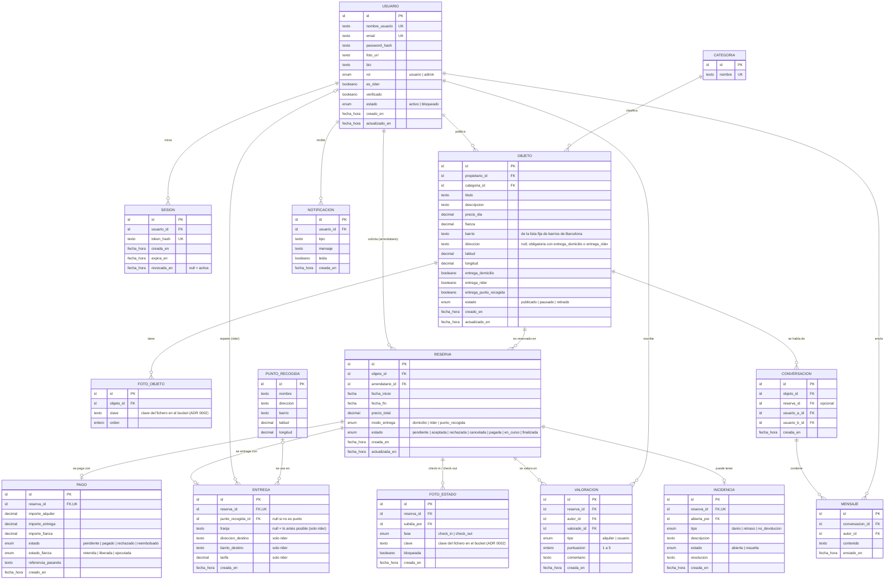

# Modelo de datos

Diagrama entidad-relación inicial de Rentit (TR-05 · #86, tarea #98). Es **independiente del stack**: los tipos son genéricos y se traducirán a las migraciones cuando esté decidido el framework y la base de datos.

Siguiendo el diseño emergente que pide la asignatura, en cada sprint solo se crean las tablas que necesitan sus historias (ver la última sección). El diagrama completo sirve de guía para que las tablas encajen entre sí.

> Generado con asistencia de IA (Claude) – revisado por Marc Sanz.

## Diagrama ER

## Tabla `usuario` (Sprint 0 · #18)

Es la única tabla que necesita el Sprint 0 (registro, inicio y cierre de sesión), junto con `sesion`.

| Campo | Tipo | Obligatorio | Restricciones | Para qué |
|---|---|---|---|---|
| `id` | id (entero autoincremental o UUID) | sí | PK | Identificador |
| `nombre_usuario` | texto (3-30) | sí | único | US-01.1: campo «nombre de usuario» |
| `email` | texto (≤ 255) | sí | único, guardado en minúsculas | US-01.1 / US-01.2: login por correo |
| `password_hash` | texto | sí | nunca la contraseña en claro (bcrypt o argon2) | Seguridad |
| `foto_url` | texto | no | | US-01.4 perfil público (S2) |
| `bio` | texto (≤ 500) | no | | US-01.4 perfil público (S2) |
| `rol` | enum `usuario`, `admin` | sí | por defecto `usuario` | US-11.01 panel admin (S3) |
| `es_rider` | booleano | sí | por defecto `false` | US-10.01 riders (S2) |
| `verificado` | booleano | sí | por defecto `false` | US-01.5 verificación (si da tiempo) |
| `estado` | enum `activo`, `bloqueado` | sí | por defecto `activo` | Bloqueo desde el panel admin |
| `creado_en` | fecha y hora | sí | por defecto «ahora» | Auditoría |
| `actualizado_en` | fecha y hora | sí | se actualiza al modificar | Auditoría |

Reglas que deben cumplir los endpoints:
- El registro rechaza un `email` o `nombre_usuario` ya existente (criterio de US-01.1).
- La contraseña tiene como mínimo 8 caracteres (criterio de Jira para US-01) y se guarda solo como hash.
- Los campos de S2/S3 se pueden añadir más adelante con una migración nueva; están aquí para que el diseño no cambie de forma.

## Tabla `sesion` (Sprint 0 · #26 y #103)

Permite que el **cierre de sesión invalide la sesión de verdad** (criterio de US-01.3), tanto si usamos cookies de sesión como tokens.

| Campo | Tipo | Restricciones | Para qué |
|---|---|---|---|
| `id` | id | PK | |
| `usuario_id` | id | FK → `usuario.id`, borrado en cascada | Dueño de la sesión |
| `token_hash` | texto | único | Hash del token o del id de sesión (nunca el valor en claro) |
| `creada_en` | fecha y hora | | |
| `expira_en` | fecha y hora | | Caducidad (por ejemplo, 7 días) |
| `revocada_en` | fecha y hora | null = activa | El logout la rellena; una sesión revocada o caducada da 401 |

Si el stack usa JWT sin estado, esta tabla funciona como lista de tokens revocados (guardando el `jti`).

## Fotos: se guarda la clave, no la URL

`foto_objeto.clave` y `foto_estado.clave` guardan la **clave del fichero en el bucket** (por ejemplo, `objetos/<idObjeto>/<uuid>.jpg`), no una URL. Las URLs para ver las fotos son prefirmadas y caducan, así que el backend las genera cada vez que se piden (ver [ADR 0002](adr/0002-almacenamiento-imagenes.md)). Antes se llamaban `url`; se cambió el nombre en la revisión del spike SP-03 (#149), antes de crear las migraciones.

## Tablas `categoria`, `objeto` y `foto_objeto` (Sprint 1 · #9)

Se crean en la migración `crea_categoria_objeto_y_foto_objeto` como parte de TR-05 (#86), para que estén en `develop` antes que las historias que las usan (US-02.x, US-03.x, US-04.x). Lo que no se ve en el diagrama:

| Decisión | Por qué |
|---|---|
| Las **categorías iniciales** las inserta la migración, no el seed | En producción solo se ejecutan las migraciones (`docs/despliegue.md`). Para cambiarlas: una migración nueva. Los tests las conservan (`resetDb()` no vacía `categoria`). |
| `latitud` y `longitud` son **opcionales** | El mapa y la búsqueda por distancia son «si da tiempo» (US-03.04); en el Sprint 1 la ubicación es el `barrio`. |
| `fianza` vale 0 por defecto | El propietario puede no pedir fianza. |
| `CHECK` en la BD: `precio_dia > 0`, `fianza >= 0` y `orden` de 1 a 5 | El backend también lo valida, pero así la BD nunca guarda datos imposibles. El `orden` único por objeto y entre 1 y 5 limita a 5 las fotos (ADR 0002). |
| Un usuario o una categoría con objetos **no se pueden borrar** | Un objeto se retira (`estado = retirado`), no se borra: las reservas lo necesitarán. Las fotos sí se borran con su objeto. |

En Prisma, los modelos son `Category`, `Item` e `ItemPhoto` (en inglés, como dice `AGENTS.md`), y el enum `ItemStatus` vale `published`, `paused` o `withdrawn`.

## Tabla `reserva` (Sprint 1 · #120)

Se crea en la migración `crea_reserva` como parte de TR-05 (#86), para que esté en `develop` antes que las historias que la usan (US-04.01 a US-04.04). Lo que no se ve en el diagrama:

| Decisión | Por qué |
|---|---|
| `modo_entrega` es **opcional en la BD** | Las reservas del Sprint 1 no lo tienen. Desde US-05.01 (Sprint 2) la API lo exige al solicitar y lo guarda junto con su `entrega` (ver más abajo). |
| `fecha_inicio` y `fecha_fin` son `DATE`, **sin hora** | El alquiler va por días y así no depende de la zona horaria. Las dos fechas cuentan: del 4 al 6 son 3 días. |
| `precio_total` se guarda en la reserva | Si el propietario cambia el precio después, la solicitud conserva el importe que vio el arrendatario. |
| `CHECK` en la BD: `fecha_fin >= fecha_inicio` y `precio_total > 0` | El backend también lo valida, pero así la BD nunca guarda datos imposibles. |
| Un objeto o un usuario con reservas **no se pueden borrar** | Las reservas son el historial de los alquileres. |

En Prisma, el modelo es `Reservation`, y los enums son `ReservationStatus` (`pending`, `accepted`, `rejected`, `cancelled`, `paid`, `in_progress`, `finished`) y `DeliveryMode` (`home`, `rider`, `pickup_point`).

## Tablas `punto_recogida` y `entrega`, y `objeto.direccion` (Sprint 2 · US-05.01 · #281)

Se crean en la migración `crea_punto_recogida_y_entrega`, en la tarea de backend de la primera historia que las usa (US-05.01). Siguen `AGENTS.md`: tablas y columnas en español, modelos en inglés (`PickupPoint`, `Delivery`).

| Decisión | Por qué |
|---|---|
| **`objeto.direccion`** (opcional, ≤ 200) | La dirección exacta del propietario. La API exige que exista si el objeto ofrece recogida en su domicilio o rider, pero la BD la deja opcional porque los objetos antiguos no la tienen. **Nunca sale en la API pública**: solo la ve su propietario y, con recogida en domicilio, el arrendatario cuando la solicitud está aceptada, pagada, en curso o finalizada. El rider la verá al aceptar el trabajo (US-10.01). |
| **`objeto.barrio` se elige de una lista fija** de barrios de Barcelona (`GET /api/barrios`) | Con el centro aproximado de cada barrio se calcula la distancia sin geocodificar nada (ADR 0005). La lista vive en el backend (`services/neighborhoods.ts`), no en la BD; los objetos antiguos con el barrio escrito a mano siguen funcionando (con la tarifa más alta). |
| Los **puntos de recogida** los inserta la migración | Son lugares públicos (bibliotecas, mercados y centros cívicos), datos de referencia como las categorías: existen también en producción y `resetDb()` no los vacía. Llevan coordenadas exactas, porque son públicos. Para cambiarlos: una migración nueva. |
| `entrega` es **0..1 por reserva** (`reserva_id` único) | Cada solicitud nueva crea su entrega en la misma transacción que la reserva. Las reservas anteriores a US-05.01 no tienen entrega ni `modo_entrega`. |
| `franja` vale `HH:MM-HH:MM` o `NULL` («Lo antes posible») | Solo tiene sentido con rider. Las franjas son de 2 h, de 9:00 a 21:00, del día de inicio. `CHECK` de formato en la BD. |
| `direccion_destino`, `barrio_destino` y `tarifa` solo se rellenan con rider | El arrendatario escribe la dirección y el barrio de entrega; la **tarifa la calcula el servidor**: distancia en línea recta entre los centros de los dos barrios × 1,3, hasta 2 km 3,00 €, de 2 a 5 km 5,00 € y más de 5 km 7,00 €. `CHECK (tarifa > 0)` cuando no es `NULL`. |
| `reserva.precio_total` **sigue siendo solo el alquiler** | La tarifa vive en `entrega.tarifa`; el pago (US-07.01) suma las dos cosas. |
| La entrega y el punto de recogida **no se pueden borrar** si hay reservas | `ON DELETE RESTRICT`: las reservas son historial. |

Todavía **no tiene** `estado`, `codigo_entrega` (US-05.02, #288) ni `rider_id` (US-10.01, #292): cada una de esas historias añade sus columnas con una migración nueva. El diagrama de arriba refleja solo lo creado hasta ahora. `sentido` (ida y vuelta) y `hora_programada` quedan sustituidos por `franja`.

## Qué tablas entran en cada sprint

| Sprint | Tablas nuevas | Historias |
|---|---|---|
| S0 | `usuario`, `sesion` | US-01.1, US-01.2, US-01.3 |
| S1 | `categoria`, `objeto`, `foto_objeto`, `reserva` | US-02.x, US-03.x, US-04.01–04.04 |
| S2 | `pago`, `punto_recogida`, `entrega`, `valoracion` (+ campos de perfil y rider en `usuario`) | US-07.01, US-05.01–05.02, US-10.01, US-08.x, US-01.4 |
| S3 | `conversacion`, `mensaje`, `notificacion`, `incidencia`, `foto_estado` | US-06.x, US-09.x, US-11.01, US-04.05 |
