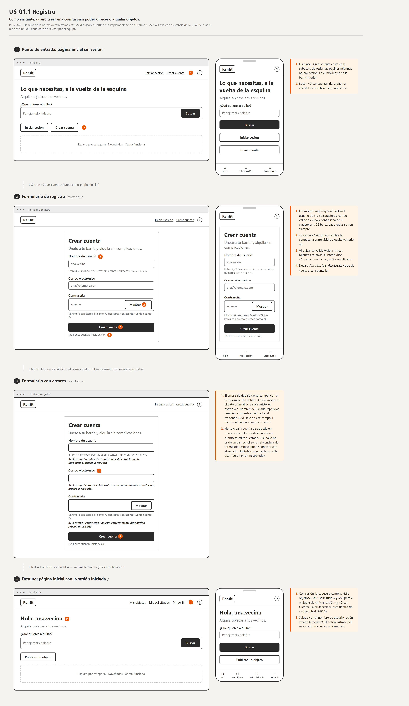

# Wireframes

**Norma del equipo (#162), tras la corrección del profesor en la demo del Sprint 0:** antes de programar el frontend de una historia de usuario se hace un **wireframe** de sus pantallas, y el equipo lo ve antes de escribir componentes.

Un wireframe es un boceto de **baja fidelidad**: qué hay en cada pantalla, desde dónde llega el usuario, qué pasa al pulsar cada cosa y cuáles son los errores. No es el diseño final: nada de colores, logo ni tipografía de la marca (eso es la guía de estilo, #158).

> Generado con asistencia de IA (Claude) – revisado por Marc Sanz, 22/10/2026.



## Cuándo

- **Toda historia que crea o cambia una pantalla** lleva su wireframe. Las historias solo de backend, no.
- Se hace **al empezar la primera tarea de frontend de la historia**, antes de escribir ningún componente.
- Si al implementar cambia algo de la pantalla, se actualiza el wireframe en el mismo PR.

## Cómo (lo hace el agente de IA, lo revisa la persona)

Los wireframes son **HTML con unos estilos comunes** que se convierten en PNG con el Playwright que ya tenemos en `e2e/`. No hace falta Figma, ni cuentas, ni dependencias nuevas, y el agente de IA (Claude, Copilot…) los puede hacer y comprobar solo.

1. Copia la plantilla: `docs/wireframes/_plantilla/` → `docs/wireframes/US-XX.YY-<nombre>/` (por ejemplo, `US-02.01-publicar-objeto`).
2. Rellena `index.html`:
   - Cabecera con el código, el título y el «Como… quiero… para…» de la historia, y su número de issue.
   - Una `<section class="wf-pantalla" data-captura="<n>-<nombre>">` por cada **pantalla o estado** del flujo (vacío, con datos, con errores, cargando, confirmación…).
   - **La primera pantalla es el punto de entrada** (desde dónde llega el usuario y qué pulsa) y **la última, el destino** (a dónde va al terminar). Entre pantallas, un `<p class="wf-flecha">` con la acción que lleva a la siguiente.
   - **Textos reales**: los de los botones, etiquetas y errores, tal como dicen los criterios de aceptación. Relleno (`.wf-lineas`) solo donde el texto no importa.
   - **Notas numeradas** (`.wf-notas`) para lo que no se ve en el dibujo: validaciones, a dónde lleva cada botón, qué datos vienen de la API, qué ve cada rol. Cada `<span class="wf-marca">n</span>` de la pantalla se explica en la nota *n*.
   - Escritorio (`.wf-escritorio`) siempre; móvil (`.wf-movil`) al lado cuando la disposición cambia.
3. Genera los PNG (la primera vez en el ordenador, `npx playwright install chromium`):
   ```bash
   cd e2e
   npm run wireframes -- US-02.01-publicar-objeto
   ```
   Crea `flujo.png` (todo el flujo) y un PNG por pantalla. Sin argumentos regenera todas las carpetas.
   **Antes de generar, borra todos los `.png` de esa carpeta** para que no queden capturas de pantallas que ya no existen. Por eso, en la carpeta de un wireframe no guardes nada más: las capturas de la pantalla real van en el PR, no aquí.
4. **Revisa los PNG** (el agente los abre y comprueba que no hay nada cortado ni solapado).
5. Commit propio al principio de la tarea: `docs(wireframe): US-02.01 Publicar un objeto (#<nº tarea>)`.
6. **Enséñalo antes de programar**: comenta en el issue de la historia con el enlace a `flujo.png` en tu rama (el repo es público, la imagen se ve en GitHub) y avisa en el grupo. Si alguien ve un problema, se corrige ahora, que cuesta menos que cambiar los componentes.
7. En el PR de la tarea, pon `flujo.png` en la sección de capturas, al lado de la captura de la pantalla real.

## Piezas disponibles (`wireframe.css`)

| Clase | Qué es |
|---|---|
| `wf-escritorio` (con `data-url`) / `wf-movil` | Marco de navegador o de móvil. Dentro: `wf-nav` y `wf-contenido` |
| `wf-nav`, `wf-logo`, `wf-enlaces`, `wf-enlace` | Cabecera y navegación |
| `wf-h1`, `wf-texto`, `wf-lineas` | Título, texto y texto de relleno |
| `wf-campo` + `label` + `wf-input` (`wf-con-error`), `wf-ayuda`, `wf-error` | Campos de formulario |
| `wf-boton` (`wf-secundario`, `wf-desactivado`, `wf-ancho`) | Botones |
| `wf-tarjeta`, `wf-centrado`, `wf-fila`, `wf-rejilla` | Contenedores y disposición |
| `wf-imagen`, `wf-caja`, `wf-aviso` | Hueco de foto, zona sin detallar (mapa, lista…) y aviso o diálogo |
| `wf-marca`, `wf-notas`, `wf-flecha` | Anotaciones y paso entre pantallas |
| `wf-icono-ayuda`, `wf-barra-inferior` | Icono de ayuda de la cabecera y barra inferior del móvil |
| `wf-columnas` (`wf-panel-izquierda`, `wf-iguales`) | Contenido con un panel lateral o dos columnas iguales; en el móvil, una debajo de otra |
| `wf-chips`, `wf-chip` (`wf-activo`) | Filtros, estados y categorías |
| `wf-calendario` (`wf-cal-mes`, `wf-cal-cabecera`, `wf-cal-pasado`, `wf-cal-rango`, `wf-cal-elegido`) | Calendario del alquiler |
| `wf-ventana`, `wf-ventana-cuerpo`, `wf-ventana-botones` | Ventana con scroll propio y botones fijos abajo |

Si hace falta una pieza nueva, se añade a `wireframe.css` (en su propio commit) en lugar de poner estilos sueltos en un wireframe, para que todos se parezcan.

## Relación con la maqueta de Figma

Las pantallas actuales de la web están en [Rentit · Pantallas](https://www.figma.com/design/iRQFKxo2roZUzXWK7URbj5) (#258). Lo que sigue compara los wireframes con la maqueta original.

La [maqueta de Figma](https://www.figma.com/design/C6S1Lj9UBkEW0FxZP8chpV/Rentit?node-id=0-1) (#157, en catalán) y estos wireframes no son lo mismo: **la maqueta define cómo se ve Rentit y el wireframe define cómo funciona cada historia**. Si no coinciden, mandan los criterios de aceptación y el wireframe, y la maqueta manda en la identidad visual ([guía de estilo](../guia-estilo.md)). Los wireframes no se redibujan con el aspecto de la maqueta, porque son de baja fidelidad.

Comparados el 04/11/2026, con el rediseño de la web (#258). Cada wireframe de la tabla lo recuerda en una nota debajo de su título.

| Marco de Figma | Wireframes | Qué coincide | Qué hace distinto la maqueta |
|---|---|---|---|
| «Home» y «Home2» | [US-03.01](US-03.01-buscar-objetos/), [US-03.02](US-03.02-filtrar-objetos/) | Cuadrícula de tarjetas con foto, precio y barrio, y panel lateral fijo de filtros | Buscador en la cabecera, botón en cada tarjeta y más filtros (fechas, distancia, valoración, sin fianza, entrega a domicilio) |
| «Ficha» (dos variantes) | [US-03.03](US-03.03-ver-objeto/), [US-04.01](US-04.01-solicitar-alquiler/), [US-05.01](US-05.01-modo-entrega/), [US-06.01](US-06.01-enviar-mensaje/), [US-01.4](US-01.4-perfil-publico/), [US-08.01](US-08.01-valorar-alquiler/) | Dos columnas con fotos, descripción y propietario, y un lateral con precio, fianza, calendario e importe | Añade lo que aún no está programado: elegir cómo recibirlo, mensajes, ver el perfil y valoraciones |
| «Log in» | [US-01.2](US-01.2-login/) | Tarjeta centrada con correo, contraseña, botón y enlace a registrarse | «Recorda’m» y «He oblidat la contrasenya» |
| «Mis objetos» | [US-02.02](US-02.02-editar-objeto/), [US-02.03](US-02.03-retirar-objeto/), [US-02.04](US-02.04-pausar-objeto/) | Filtros por estado, «Publicar un objeto» y botones de cada objeto | Nada relevante |

**Cabecera:** la maqueta tiene logo, buscador, «Log in» y un icono de calendario. La web y los wireframes llevan el logo, enlaces de texto y un icono de ayuda, con el buscador en la página. En el móvil, la navegación es una barra inferior con iconos.

**Para decidir en el Sprint Planning:**
- Si los filtros de la maqueta que no tienen historia (fechas, distancia, valoración, sin fianza) entran en el backlog.
- Dónde encaja elegir la entrega (US-05.01) ahora que solicitar el alquiler está en el lateral de la ficha.
- Si «Recorda’m» y «He oblidat la contrasenya» pasan a ser historias.
- Dónde se enseñan las valoraciones en la ficha: US-08.01 y US-08.02 solo dibujan cómo se valora.
- Qué es el icono de calendario de la cabecera. La maqueta no lo aclara.

Las demás historias con wireframe no tienen marco en la maqueta: siguen la paleta de la guía de estilo cuando se programan.

## Ejemplo

[`US-01.1-registro/`](US-01.1-registro/): el registro del Sprint 0, dibujado después a partir de lo que se implementó, para que se vea el resultado. Va de la página inicial sin sesión (punto de entrada) al formulario, sus errores y la página inicial con la sesión iniciada (destino).
